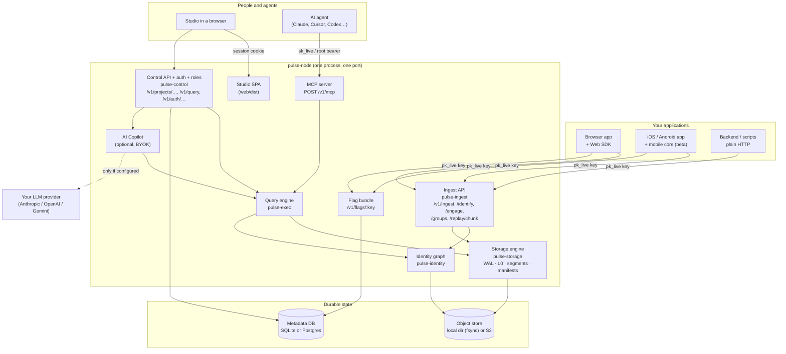
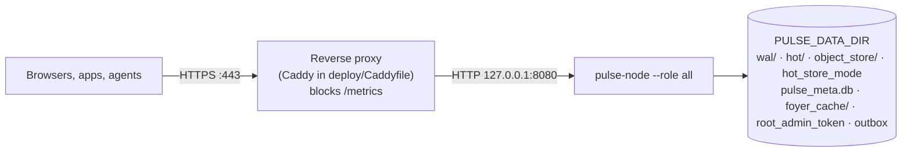
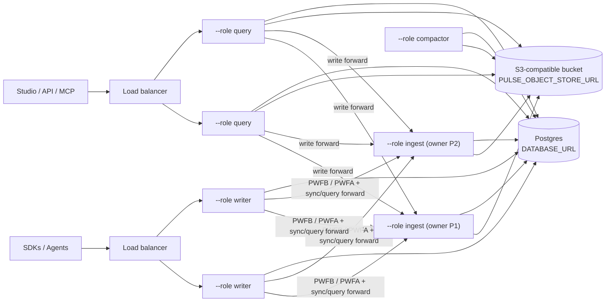

# System architecture

Pulse is one Rust binary, `pulse-node`. It contains:

- event ingest
- the storage engine
- the query engine
- the control plane (accounts, keys, flags, experiments, dashboards)
- the Studio web UI
- an MCP server

By default all of this runs in one process. There is no Kafka, ClickHouse, Redis or ZooKeeper to operate. The only external dependency you *may* add is shared storage for multi-node setups: an S3-compatible bucket and Postgres.

This page is the map. [How Pulse works](how-it-works.md) follows the data step by step, and [Design decisions](adr/README.md) explains why it is built this way.

## High-level architecture

The diagram shows the following boundaries:

- **Two kinds of key.** A *public ingest key* (`pk_live_…`) can only write events and read flags. An *admin credential* (root token, `sk_live_…` project key, or `ps_…` Studio session) reads data and changes configuration. The two key types are never interchangeable: an ingest key on an admin route gets `403`.
- **Two stores.** Event data, identity and profiles live in the **object store**. Configuration (organisations, users, projects, keys, flags, experiments, dashboards, audit log) lives in the **metadata DB**.
- **One outbound path.** Pulse only talks to the outside world when you configure it to:
  - the Copilot's LLM provider
  - webhooks for alerts
  - warehouse export to your S3 bucket
  - Google sign-in

  All outbound requests go through an SSRF-guarded client (`PULSE_ALLOW_PRIVATE_ENDPOINTS` relaxes it for local testing).

## Architecture inventory

| Component | Location | Technology | Responsibility | Inputs → outputs | Key dependencies | Failure handling | Scaling knobs |
|---|---|---|---|---|---|---|---|
| **Node runtime** | `crates/pulse-node` | Tokio, Axum, mimalloc | Parses flags and env, wires every component, serves HTTP, health, metrics, static Studio, graceful shutdown | Process config → running services | All crates below | `/readyz` turns `503` during drain (`PULSE_SHUTDOWN_DRAIN_MS`); flushes all projects on `SIGTERM` | `--role all\|ingest\|writer\|query\|compactor` |
| **Wire formats** | `crates/pulse-wire` | serde, zstd, xxh3 | Event schema, JSON and binary `PLSB` batch codecs, `PLSR` replay frames, flag bucketing | Bytes ↔ `WireEvent`, replay ops | — | Bounded decompression (64 MiB), per-field caps | — |
| **Ingest** | `crates/pulse-ingest` | Axum, quinn (QUIC) | Auth by ingest key, decode, rate limit, lexicon governance, clock-skew fix, bounded W1 writer buffer (`20 ms` / `1 MiB`), per-bucket WAL group commit + dedup, per-bucket processor apply, stateless `writer` `PWLF` v2 `writer_log/` + async `PWFB`/`PWFA` forwarder, synchronous `/v1/identify`, `/v1/engage`, `/v1/groups`, and `/v1/replay/chunk` (with `project_owner` HTTP/QUIC forwarding) | HTTP/QUIC requests → writer buffer → WAL or `writer_log/` → L0 rows; sync profile/replay calls → durable owner stores (`canonical_uid` / `replay_offset_kb`) | wire, identity, storage | `429` on rate limit, `ingest_buffer_backpressure`, `writer_log_backpressure`, `l0_backpressure`, `log_backpressure`, or `hot_segment_backpressure`; `503` on sticky WAL/`writer_log` failure, `not_owner`, `forward_loop_detected`, or storage/profile unavailability; `409`/`500`/`503` propagated on sync profile/mixed-batch calls | `PULSE_WRITER_FLUSH_MS`, `PULSE_WRITER_FLUSH_BYTES`, `PULSE_INGEST_BUFFER_*_MAX_MB`, `PULSE_WRITER_LOG_*`, `PULSE_INGEST_EVENTS_PER_SEC`, `PULSE_INGEST_BURST_SECS` |
| **Storage engine** | `crates/pulse-storage` | object_store, Vortex, Roaring, SlateDB, ring | WAL, L0 buffers, local `hot/segments/` & `hot/replay/` flush, 7-step S3 upload cycle, cold S3 merge (`PULSE_COLD_MERGE_IDLE_SECS`), manifests (CAS), erasure, replay store, profile store, optional envelope encryption | Rows → segments; snapshots → readers | object_store backend | CRC-checked WAL replayed on start; corrupt WAL frames quarantined; intent replay & `hot/segments/` sweep; fail-closed dedup seeding (`503`); `ProfileStore` maps I/O/fenced SlateDB errors to `503` (`Unavailable`); manifest CAS retries; maintenance errors counted in `/metrics` | `PULSE_NUM_BUCKETS`, `PULSE_L0_MAX_ROWS_PER_BUCKET`, `PULSE_UPLOAD_INTERVAL_SECS`, `PULSE_COLD_MERGE_*`, `PULSE_HOT_SEGMENTS_*_MAX_MB`, `PULSE_OBJECT_STORE_URL` |
| **Agent store** | `crates/pulse-agent` | object_store, PLST/PTWL/PLSS, foyer, moka | Agent trace/span WAL (`agent_wal/`), sharded L0, local `hot/agent_segments/` & `agent_manifests/`, cycle upload to S3 `agent_segments/` & `agent_published/`, physical pre-expiry erasure, `writer_offsets` (`T_expire = 7d`) idempotent forwarded ingest (`PTWL` + `AgentManifest`), evaluators, OTLP GenAI normalizer | Agent traces/OTLP → `PTWL` (or `writer_log/` `PWLF` v2 on `writer`) → `PLSS` + evals | storage, control | CRC-checked WAL replay; `NotWriter`/`StaleWriter`/`NotOwner` fenced (`503`); upload intent sweep; urgent pre-expiry physical purge before `agent_erasure_tombstones.expires_at_ms` | `PULSE_AGENT_L0_*_MAX_MB`, `PULSE_UPLOAD_INTERVAL_SECS`, `PULSE_COLD_MERGE_IDLE_SECS` |
| **Identity graph** | `crates/pulse-identity` | SlateDB, union-find, Roaring | `distinct_id` ↔ dense u32, anonymous → user merges | identify/alias calls → canonical map | object store | Flushed before events are written; recovery fails loudly on a missing chunk; `409` on merging two identified users | Read-only Candidate B snapshot copies (`<data_dir>/query_hot`) or `DbReader` on query nodes |
| **Query engine** | `crates/pulse-exec` | Tokio, rayon, foyer, moka, DataFusion (custom properties only), DDSketch | Insights, funnels, retention, flows, cohorts, session search, export | Query AST + snapshot → result JSON | storage, identity | Deadline, row and memory budgets, admission semaphores; partial results discarded | `PULSE_QUERY_*`, `PULSE_AUTO_SAMPLE_MIN_ROWS`, `PULSE_CACHE_MEMORY_MB` |
| **Control plane** | `crates/pulse-control` | Axum, sqlx (SQLite/Postgres), Argon2, AES-GCM | Accounts, orgs, roles, API keys, lexicon, cohorts, dashboards, flags, experiments, alerts, BYOK, audit log, erasure, import/export, MCP, Copilot, cached `project_owner` router (`MetaOwnerDirectory`) + `/internal/v1/forward/admin/*` + `writer` `/v1/projects/:id/*` forwarding + `AgentWriterBackend` | Admin/API requests → DB rows, owner forward or query calls | exec, storage, identity, metadata DB | Deny-by-default role check per route; CSRF check for cookie writes; secrets sealed by the KEK; `503` on loop (`forward_loop_detected`) or unreachable owner | `DATABASE_URL`, `PULSE_VAULT_KEK`, `PULSE_NODE_NAME`, `PULSE_ADVERTISE_ADDR` |
| **Studio** | `web/` | React 18, Vite, Tailwind | The web UI: workspaces for trends, funnels, journeys, retention, replays, users, cohorts, experiments, events & privacy, security | User actions → `/v1/...` calls | Control API | — | Static files; served by query/all nodes |
| **Web SDK** | `sdks/ts-web` | TypeScript, zero deps | Tracking, identity, profiles, flags, masked wireframe replay, autocapture | App calls → ingest requests | Ingest API | `localStorage` queue, jittered backoff, `keepalive` flush on hide, dedup ids | `flushBatchSize`, `flushIntervalMs`, `maxQueuedEvents` |
| **Mobile core (beta)** | `crates/pulse-sdk-core`, `sdks/bindings-gen` | Rust, UniFFI → Swift/Kotlin | The same SDK features natively, with a CRC'd disk WAL | App calls → ingest requests | Ingest API | 10 MiB disk queue, jittered backoff | `flush_batch_size`, `flush_interval_ms` |
| **React Native SDK (undocumented)** | `sdks/react-native` | TypeScript wrapper around the Web SDK, native recorder modules | RN screens, lifecycle, native snapshots | — | Web SDK | — | Not in CI or releases; see [Limitations](limitations.md) |
| **Claude Code plugin** | `integrations/claude-code-plugin` | MCP config + skills | Connects Claude Code to `/v1/mcp`, adds funnel-analysis and instrumentation skills | — | MCP server | — | — |

## Node roles and deployment

### What a release ships

Every `v*` tag runs `.github/workflows/release.yml`, which publishes:

| Artifact | Where | Notes |
|---|---|---|
| `pulse-linux-x86_64.tar.gz`, `pulse-linux-aarch64.tar.gz` | [GitHub Releases](https://github.com/sswapnil2/analytics-system/releases) | `pulse-node`, the built Studio, the `deploy/` files, `LICENSE`, `NOTICE`. Built on Ubuntu 22.04 (needs glibc 2.35+) and smoke-tested with `/healthz` |
| `SHA256SUMS` | GitHub Releases | Checksums for the tarballs and the SDK |
| `pulse-analytics-ts-web-<ver>.tgz` | GitHub Releases | The Web SDK, installable with `npm install <url>` |
| `ghcr.io/sswapnil2/pulse:<ver>` and `:latest` | GitHub Container Registry | Multi-arch (amd64, arm64) Debian image built from the tarballs; runs as uid 10001 |

There are no macOS or Windows binaries, and nothing is published to npm unless the repo's `NPM_TOKEN` secret is set. See [Quickstart → Install](quickstart.md#1-install).

### Single node (default)

One process does ingest, queries, flushing, compaction and serves the Studio. The repo ships this setup in `deploy/`:

- `pulse.service`: a hardened systemd unit (`ProtectSystem=strict`, `NoNewPrivileges` and so on) that binds to `127.0.0.1:8080`.
- `Caddyfile`: TLS termination and compression, and `403` on `/metrics`.
- `pulse.env.example`: an environment template.
- `backup.sh`: a nightly tarball of the data directory, with an optional `rclone` upload.

The Docker image (`ghcr.io/sswapnil2/pulse`) runs as uid 10001 with `/data` as its volume. See [Self-hosting in the cloud](self-hosting-cloud.md).

### Several nodes by role

| Role | Serves | Background work |
|---|---|---|
| `all` | Everything | Flush, compaction, S3 upload/publish, alert checks every 5 min (for owned projects), owner forwarding for remote projects |
| `ingest` | `/v1/ingest` and friends, `/v1/agent/traces`, `/v1/otel/v1/traces`, flag bundle, `/internal/v1/forward/*`, `/healthz` | L0 → segment flush, identity commits, S3 upload/publish, alert checks every 5 min (for owned projects) |
| `writer` | `/v1/ingest` and friends, `/v1/agent/traces`, `/v1/otel/v1/traces`, `/v1/projects/:id/*` (forwarded), `/healthz`, `/readyz`, `/metrics` | Stateless buffer (`20 ms` / `1 MiB`) → `writer_log/` (`PWLF` v2) → async `WriterForwarder` to each project's `project_owner` (zero SlateDB, zero S3 calls) |
| `query` | Admin and query API, Studio, MCP, flag bundle, `/healthz` | Discovers S3 `published/` and `agent_published/` manifests, restores Candidate B identity/profile snapshots into `<data_dir>/query_hot`, reads S3 `segments/`, `agent_segments/`, and both local/S3 `replays/`, forwards storage-writing mutations to `project_owner`, syncs `erased_uids` and `agent_erasure_tombstones` from Postgres; alert checks |
| `compactor` | `/healthz` | Manifest refresh and segment compaction for projects it is eligible for (idle in `PULSE_HOT_STORE=local` mode when `PULSE_UPLOAD_INTERVAL_SECS > 0`; requires shared local `hot/` or `PULSE_HOT_STORE=object`) |

Multi-node needs a shared object store and Postgres, plus one `PULSE_VAULT_KEK` shared by every node (so every node can unseal stored secrets and verify internal node-to-node forward tokens), and distinct `--node-name` (`PULSE_NODE_NAME`) / `--advertise-addr` (`PULSE_ADVERTISE_ADDR`) values on each node.

- **Ownership & routing (`project_owner`).** Each project has one authoritative owner in `project_owner` (placed on the least-loaded healthy `all`/`ingest` node when created via `POST /v1/projects`). Every node caches `project_owner` in `MetaOwnerDirectory` (`30 s` TTL with instant invalidation on `503 not_owner`, `307`, or transport errors).
  - Unforwarded async ingest (`/v1/ingest`, `/v1/agent/traces`, `/v1/otel/v1/traces`) hits any stateless `writer` node (`200`, buffered to `writer_log/` `PWLF` v2 and forwarded idempotently to the owner) or the owning `ingest`/`all` node directly (non-owner `ingest`/`all` nodes return `503 not_owner`).
  - Sync profile/replay calls (`/v1/identify`, `/v1/engage`, `/v1/groups`, `/v1/replay/chunk`, QUIC identify/replay), `/v1/projects/:id/*` on `writer`, and remote project/query/admin calls on non-owner `all` nodes forward transparently to the owner's `/internal/v1/forward/*` endpoints (bounded to 1 hop; loops return `503 forward_loop_detected`).
  - `query` nodes serve analytics/agent reads from S3 `published/` + `agent_published/` and forward the 4 storage-writing mutations (`DELETE /users/:distinct_id`, `POST /import`, `DELETE /agent/traces/:trace_id`, `POST /agent/erasure`) to the owner.
  - Background metric/agent alerts fire at most once per transition on the owning node (`alert_claims`).
- **Remaining per-node state.** Rate limits, login lockouts, in-memory event dedup windows (when scaling multiple `writer`s in front of an owner, async forwarding deduplicates at the owner or via `writer_offsets` for agent traces), and OAuth state remain in memory **per node**. See [Limitations](limitations.md#operational-limitations).

## Scaling considerations

What the code does to scale on one machine:

- **Buckets.** Users are spread over buckets (16 by default, up to 256). Ingest appends and flushes run per bucket in parallel, and queries prune whole buckets.
- **Columnar segments with rich footers.** Time-range and event filters often skip segments without reading them. Unfiltered totals and uniques can come from footers alone.
- **Sampling only above 10 M rows**, and always disclosed in the result. See [How queries work](how-it-works.md#4-how-queries-work).
- **A hybrid RAM and disk segment cache.** The memory part is `PULSE_CACHE_MEMORY_MB` (128 MB by default). The disk part is 512 MiB under `foyer_cache/` on query nodes.
- **Admission control and budgets.** One large query cannot take over the node.

Performance figures: the repo has a latency SLO test, `crates/pulse-exec/tests/scale_slo.rs`, run by `./scripts/bench_scale.sh`. It asserts p50/p75/p99 budgets in release builds on synthetic data (100k to 10M events). The README quotes one measured run on an M-series Mac. Those numbers come from one machine and one dataset. They are not a guarantee, and **no figures are published here for production hardware**. Run `bench_scale.sh` on your own hardware.

## Failure handling

| Failure | What happens |
|---|---|
| Process crash (`SIGKILL`) after an ingest `200` | Already-WALed events are replayed from the fsynced WAL into L0 and dedup windows are re-seeded; at most the un-WALed writer memory buffer (`<= PULSE_WRITER_FLUSH_MS` / `<= PULSE_WRITER_FLUSH_BYTES`, default `20 ms` / `1 MiB`) can be lost. Clean `SIGTERM` drains 100% of buffered events before exit. |
| Crash during a segment flush or S3 upload cycle | The manifest commit is atomic (create-if-absent), and each upload cycle writes `upload_intent.json` before any S3 PUT. On restart, unreferenced S3 segments/snapshots from `upload_intent.json` and unreferenced `hot/segments/` files are swept cleanly; the WAL still holds uncommitted rows. |
| S3 unreachable during open (dedup seeding) or sustained ingest | Opening a project fails closed with `503` if recent S3 segments cannot be read for dedup seeding (never seeding empty dedup rings). While S3 stays unreachable, event ingest continues to local `hot/segments/` until `2x` `PULSE_HOT_SEGMENTS_*_MAX_MB`, then returns `429` (`hot_segment_backpressure`); `/v1/replay/chunk` and `/v1/agent/traces` continue writing locally to `hot/replay/` and `agent_wal/`/`hot/agent_segments/` without S3 calls. |
| Corrupt WAL object | It fails its CRC check, is moved to `wal_corrupt/`, and is logged. |
| Ingest faster than processor or flush | `429 Retry-After: 1` (`ingest_buffer_backpressure`, `log_backpressure`, or `l0_backpressure`). The SDKs back off and retry. |
| Too many events per second | `429 Retry-After`, from the per-project token bucket. |
| Expensive query | Fails with timeout, too-large or memory-exceeded. It never takes the node down. |
| Too many concurrent queries | Queued up to the deadline, then `Overloaded`. |
| Background flush or compaction error | Counted in `pulse_maintenance_errors_total{kind}`, logged, and retried on the next 5 s tick. |
| Object store or metadata DB down | `/readyz` returns `503` with the failing check. |
| `SIGTERM` | Readiness drops, then the drain delay passes, background tasks stop, HTTP gets 15 s to finish, and every project's L0 is flushed. |

## Observability of Pulse itself

- `GET /healthz`: liveness.
- `GET /readyz`: checks drain state, a metadata DB ping and an object store `HEAD`, each with a 2 s timeout.
- `GET /metrics` (Prometheus): protect it with `PULSE_METRICS_TOKEN`. It exposes:
  - `pulse_http_requests_total` and `pulse_http_request_duration_seconds`, by route template
  - `pulse_ingest_events_{accepted,deduped,dropped}_total` and `pulse_ingest_dead_lettered_events_total`
  - `pulse_ingest_batches_total`
  - `pulse_writer_flush_bound_{ms,bytes}`, `pulse_writer_flushes_total{reason}`
  - `pulse_writer_buffer_{bytes,capacity_bytes,events,batches}`
  - `pulse_wal_bytes`, `pulse_ingest_log_lag_bytes`, `pulse_ingest_log_lag_limit_bytes`
  - `pulse_ingest_apply_lag_seconds`, `pulse_ingest_apply_queue_{records,events}`
  - `pulse_queries_executed_total`
  - `pulse_maintenance_errors_total{kind}`
  - `pulse_l0_bytes` and `pulse_l0_rows`
  - `pulse_hot_segment_bytes`
  - `pulse_open_projects`
  - `pulse_last_query_latency_seconds`
  - `pulse_ready`
- Alert rules: `deploy/prometheus-alerts.yml` (includes warning/critical apply-lag alerts well below the 15-minute `DEDUP_WINDOW_MS`, buffer saturation, log-lag, hot-segment, dead-letter, and maintenance-error rules).
- Logs: `tracing` to stdout, filtered by `RUST_LOG` (default `info,slatedb=warn`).

Pulse does not export OpenTelemetry traces of itself.

## Repository map

| Path | What it is |
|---|---|
| `crates/pulse-node` | Binary entry point and wiring (`src/main.rs`, `src/lib.rs`), metrics, demo seeder |
| `crates/pulse-wire` | Wire formats and bucketing |
| `crates/pulse-ingest` | Ingest HTTP/QUIC and the ingest pipeline |
| `crates/pulse-storage` | Storage engine, WAL, segments, manifests, encryption |
| `crates/pulse-identity` | Identity graph |
| `crates/pulse-exec` | Query engine |
| `crates/pulse-control` | Control API, auth, DB, migrations, MCP, Copilot, experiments |
| `crates/pulse-sdk-core` | Mobile SDK core |
| `web/` | Studio |
| `sdks/` | Web SDK, React Native wrapper, UniFFI bindings |
| `deploy/` | systemd, Caddy, env template, backup script |
| `examples/` | Web, iOS and Android demo apps |
| `integrations/claude-code-plugin` | Claude Code plugin |
| `scripts/` | End-to-end check, scale benchmark |
