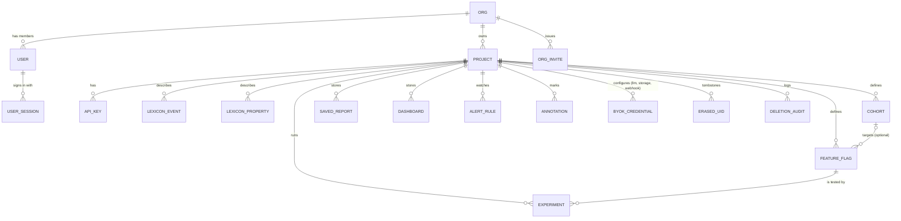
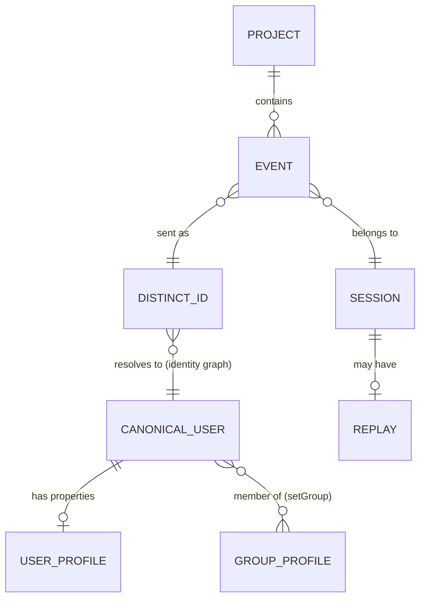

# Data model

Pulse keeps data in two places:

- The **metadata database** (SQLite by default, Postgres for multi-node) holds configuration and accounts. Its schema is the set of migrations in `crates/pulse-control/migrations/`.
- The **object store** holds event data, the identity graph, profiles and replays. Their formats are in `crates/pulse-storage` and `crates/pulse-identity`.

## Accounts, projects and configuration

| Entity | Table (migration) | Notes |
|---|---|---|
| Organisation | `orgs` (0006), `organizations` (0001) | Two org tables exist for historical reasons, and the code writes to both. Treat them as one concept. |
| User | `users` (0002, 0007) | Each user is in exactly **one** organisation (`users.org_id`). Role: `viewer` / `member` / `admin` / `owner`. Passwords are Argon2-hashed. `google_sub` is set for Google sign-ins. |
| User session | `user_sessions` | Stored as a SHA-256 hash of the `ps_…` token; 30-day expiry. |
| Invite, password reset, email verification | `org_invites`, `password_resets`, `email_verifications` (0007) | One-use tokens, stored hashed. |
| Project | `projects` | Belongs to one org (`projects.org_id`) and has a time zone. Every piece of analytics data is scoped to one project. |
| API key | `api_keys` | `pk_live_…` (role `ingest_and_flags`) or `sk_live_…` (role `admin`). Only a SHA-256 hash and a display prefix are stored. |
| Lexicon | `lexicon_events`, `lexicon_properties` | Status `active` / `hidden` / `dropped`, descriptions, owner, and the `pii_masked` flag. |
| Custom events and properties, lookup tables | `custom_events`, `custom_properties`, `lookup_tables` | Virtual schema, evaluated at query time. |
| Cohort | `cohorts` | A behavioural definition or a fixed list of users. |
| Saved report, dashboard | `saved_reports`, `dashboards` | Saved query bodies and card layouts. |
| Feature flag | `feature_flags` | Unique per `(project_id, flag_key)`: rollout percentage, variants, optional `targeting_cohort_id`. |
| Experiment | `experiments` | Runs on one flag. |
| Alert rule | `alert_rules` (0004) | Event count threshold, optional `webhook_url`. |
| Annotation | `annotations` (0010) | Markers on charts. |
| BYOK credential | `byok_credentials` (0005) | Unique per `(project_id, category)`. Secrets are sealed with the cluster KEK. |
| Erasure | `erased_uids` (0004, 0009), `deletion_audit_log` | Tombstone with `erased_at_ms`, plus an audit row with a masked id. |
| Import dedup | `import_seen` (0009) | Event ids taken in by `/import`, kept for 30 days. |
| Cluster keyring, audit log | `system_keyring`, `enterprise_audit_log` (0005) | Root-only. |

**Cardinalities.** The diagram shows the relationships the code relies on. Only one foreign key is enforced by the database: `byok_credentials.project_id → projects(id) ON DELETE CASCADE`. Every other link is kept by application code, not by database constraints.

## Events, users and sessions

An **event** (`WireEvent`, `crates/pulse-wire/src/event.rs`) has these fields:

| Field | Meaning |
|---|---|
| `event_uuid` | 16-byte id used for deduplication. Derived from `messageId` / `insert_id` if you send those, otherwise from a hash of the content. |
| `event_name` | The event's name, up to 255 characters. |
| `distinct_id` | Who did it: an anonymous id or your user id. |
| `routing_seed` | A stable device install id. It decides which storage bucket the event goes to. |
| `session_id` | Defaults to `sess_<distinct_id>` if missing. |
| `client_event_ts_ms`, `client_sent_ts_ms` | When it happened, and when it was sent (used for clock-skew correction). |
| `props` | Typed properties: null, bool, int64, float64 or string (up to 8 KiB). |
| `replay_offset_kb` | Where this event falls in the session's replay. |

Storage keeps the dense 32-bit id of `distinct_id`, never the string. The **identity graph** maps many distinct ids, for example a device's anonymous id and the user id after login, to one **canonical user**. That mapping is applied at query time.

**User profiles** (`profiles/{project}` in SlateDB) hold the properties you set with `$set`, `$set_once`, `$increment`, `$append`, `$union`, `$remove` and `$unset`. A profile view merges the properties from every id that belongs to the user, and the newest value wins.

## On-disk layout

| Object path | Contents |
|---|---|
| `wal/{proj}/bucket_NNN/epoch_E_seq_S.wal` | Events acknowledged but not yet in a segment (`<data_dir>/wal/` in `local` mode) |
| `hot/segments/{proj}/{YYYYMMDD}/bucket_NNN/{id}.pvtx` | Local L0-flushed columnar segments awaiting the 7-step upload cycle (`<data_dir>/hot/` in `local` mode) |
| `segments/{proj}/{YYYYMMDD}/bucket_NNN/{id}.pvtx` | Uploaded S3 columnar events for one day and bucket, with an inverted index and a session index |
| `manifests/{proj}/epoch_N.json` | Authoritative local manifest: active segments, footers, and persisted `pending_s3_deletes` (`<data_dir>/hot/manifests/` in `local` mode) |
| `manifests/{proj}/upload_intent.json` | Local upload-cycle intent record for crash-safe cleanup of orphaned S3 segments/snapshots (`<data_dir>/hot/manifests/` in `local` mode) |
| `published/{proj}/pub_{publish_seq:012}.json` | Dense-sequence published S3 manifest (`writer_generation`, `source_local_epoch`, `high_water_mark`, `snapshot_ref`) |
| `published/{proj}/snapshots/{identity,profiles}_*.pzst` | Candidate B logical snapshots of identity and profile state |
| `identity/{proj}` | Identity graph (SlateDB; `<data_dir>/hot/identity/` in `local` mode) |
| `profiles/{proj}` | User and group profiles (SlateDB; `<data_dir>/hot/profiles/` in `local` mode) |
| `replays/{proj}/{session}/{seq}.plsr` | Replay chunks |

With `PULSE_HOT_STORE=local` (the default), `wal/` (plus `wal_corrupt/`, `wal_dead/`, `agent_wal/`, `agent_wal_corrupt/`) lives under `<data_dir>/wal/` and `identity/`, `profiles/`, `manifests/`, and `hot/segments/` live under `<data_dir>/hot/`, while `segments/`, `published/`, and `replays/` live in `<data_dir>/object_store/` or your S3 bucket (`PULSE_HOT_STORE=object` puts all paths in the object store). Remote `--role query` nodes keep restored snapshot copies under `<data_dir>/query_hot/`. The data directory also holds:

- `hot_store_mode`: persistent `local` / `object` mode marker
- `pulse_meta.db`: the SQLite metadata DB
- `foyer_cache/`: the query cache
- `root_admin_token`
- `outbox`: email-verification and reset links
- `.pulse_cluster.kek`: if you have not set `PULSE_VAULT_KEK`
