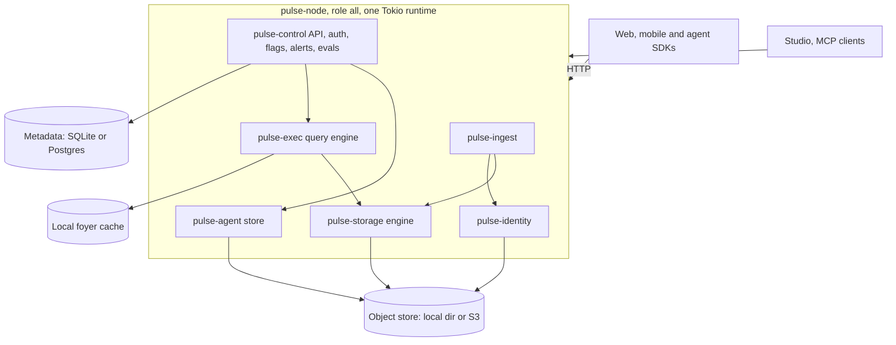
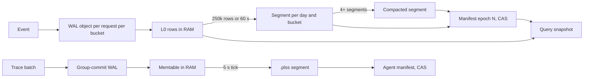
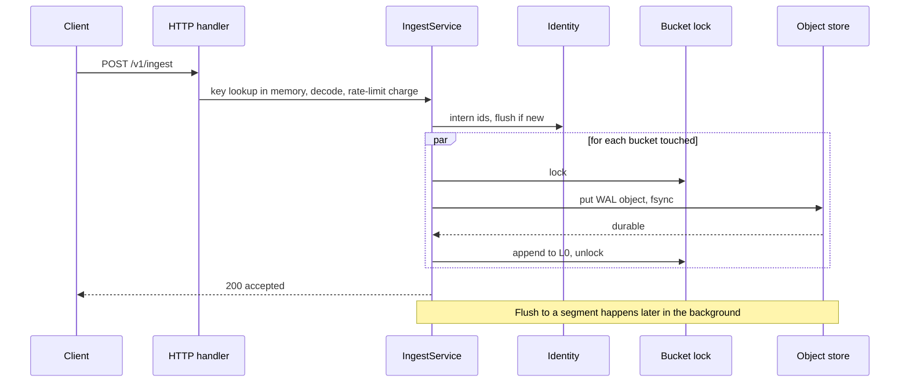
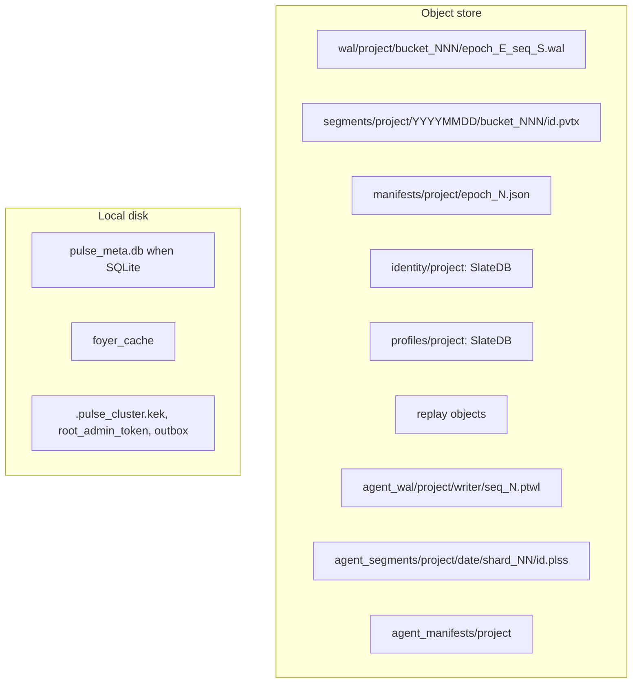
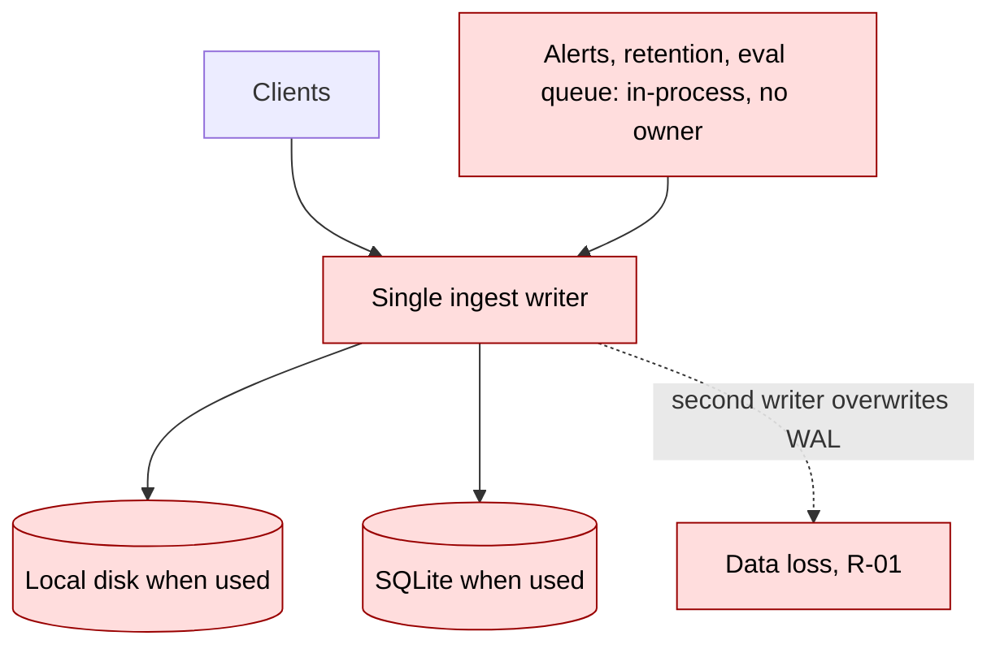
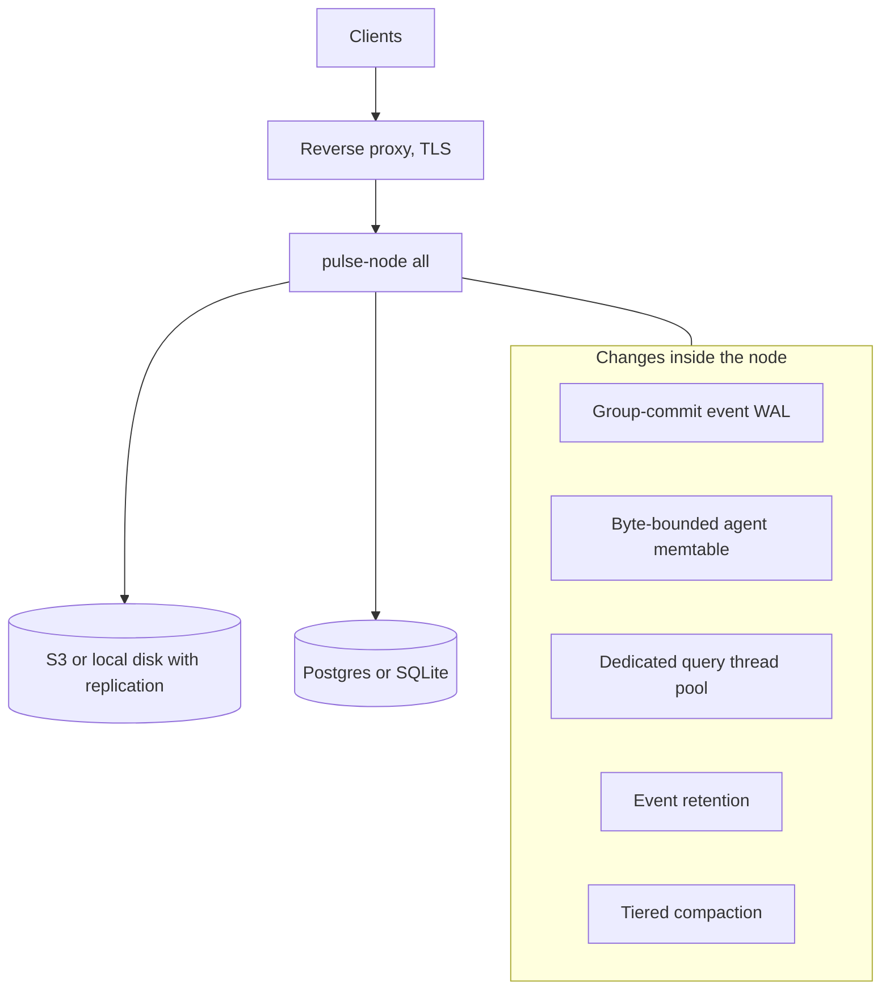
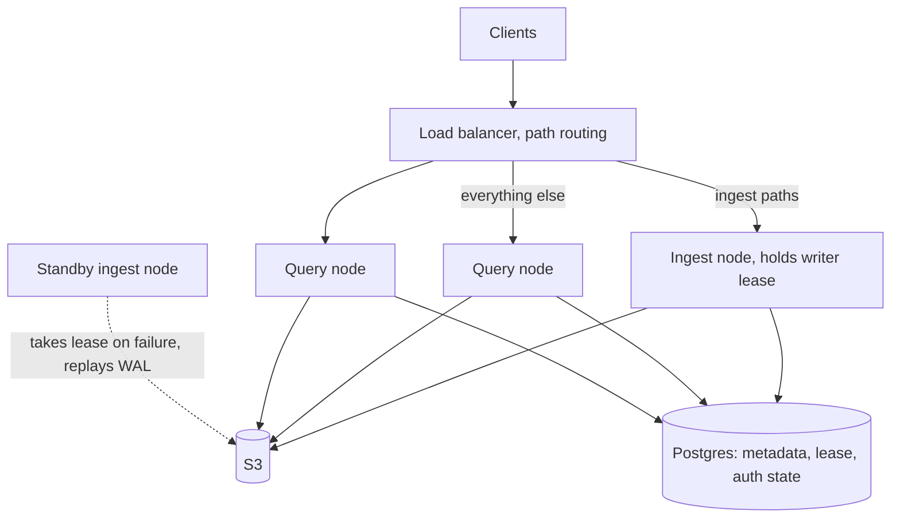
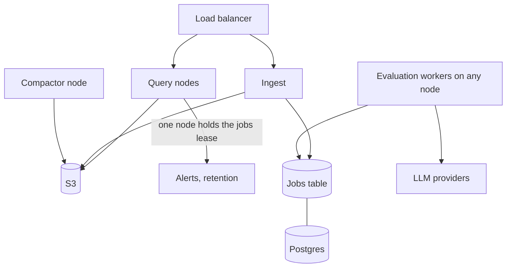
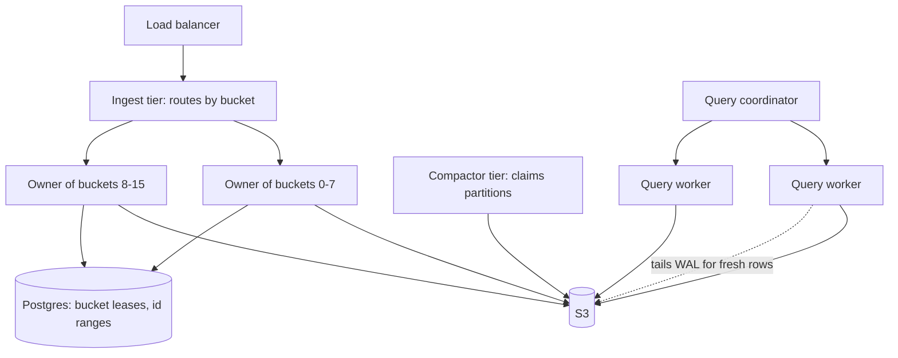

# Pulse scalability and distributed-architecture review

Reviewed: `main` at `9fe30be` (v0.1.2), 21 November 2026.

How to read this document:

- **[code]** means the claim was read in the source at the cited `file:line`.
- **[measured]** means it was measured in this review (section 9). Everything measured ran on one laptop with synthetic data.
- **[inference]** means it follows from the code but was not reproduced.
- **[estimate]** means arithmetic on stated assumptions.

Proposed architecture is always labelled as proposed. Line numbers refer to the reviewed commit.

---

## 1. Executive summary

**Is Pulse architecturally sound?** Yes, for one node. The core choices are the right ones for this product: one binary, an object store as the only durable data plane, immutable segments, a manifest committed by compare-and-swap, a write-ahead log in the object store, and a small SQL metadata store (SQLite or Postgres). Node roles (`all`, `ingest`, `query`, `compactor`) already exist. Nothing here has to be thrown away.

**Can it evolve beyond one machine?** Yes, without a rewrite, but not today. Reads scale out now: several `query` nodes over one object store and Postgres work, with stale-by-up-to-65-seconds data. Writes do not: two ingest nodes writing the same project lose acknowledged events silently (R-01).

**Biggest scalability risk.** The event write path does one fsync'd object write per request per bucket, serialised by a per-bucket lock, with no group commit. Measured ceiling on local disk: about 15–18 ingest requests per second with the default 16 buckets, whatever the batch size. With the object store in memory the same node sustained 324,000 events/s, so storage commit latency is the entire bottleneck (R-02).

**Biggest reliability risk.** Running a second ingest node. Both derive the same WAL object names from the manifest and overwrite each other with a plain `put`; the fencing field that should prevent this is never written (R-01). The README presents node roles as a horizontal-scaling feature, so an operator can reach this state by following the docs.

**Biggest architectural constraint.** The identity graph. User ids are interned to dense `u32`s from a process-local counter, the whole graph lives in RAM on every node, and it is single-writer per project (R-03, R-09). Every segment stores those `u32`s, so this is the one design decision that shapes how ingest can be partitioned.

**Does it need a rewrite?** No. Every Critical and High finding has an incremental fix inside the existing structure.

**What to address first.**

1. Refuse to start a second writer on a project (a lease), so the data-loss case cannot happen by accident.
2. Group-commit the event WAL.
3. Bound the agent-trace memtable and trace size.
4. Give background jobs a single owner.

Five smaller fixes were implemented and tested in this review (section 13, "Done in this review").

---

## 2. Architecture overview (current, from code)

Pulse is one process, `pulse-node`, built from nine crates and wired in `crates/pulse-node/src/lib.rs`. One Tokio runtime serves HTTP, ingest, queries and background loops (`main.rs:10`).

Two independent storage engines share one object store:

| Engine | Crate | Data | Write path |
|---|---|---|---|
| Event store | `pulse-storage` | Product events, session replay, profiles, identity | Per-bucket WAL object per request, L0 in memory, L1 Vortex segments per (UTC day, bucket) |
| Agent trace store | `pulse-agent` | Traces, spans, payloads | Per-project group-commit WAL, memtable, `.plss` segments per (day, shard of 8) |

Metadata (orgs, projects, keys, flags, experiments, alerts, evaluations) is in SQLite by default, or Postgres when `DATABASE_URL` is set (`pulse-control/src/db.rs:227-259`).

Diagrams 1–6 in section 12 show the current system.

---

## 3. Architecture inventory

| Component | Technology | State | Scales by | Failure behaviour | Main bottleneck |
|---|---|---|---|---|---|
| HTTP API and Studio | axum on Tokio; static files | Stateless, except in-memory OAuth state and login throttle (`api/auth.rs:98-109`) | Adding `query` nodes | Node loss drops in-flight requests | No timeout or concurrency layer on admin and query routes |
| Event ingest | `pulse-ingest` | Stateful: L0 rows, dedup rings, rate buckets, WAL sequence counters | Vertical only (one writer per project) | Acked rows are in the WAL and replay on project open | One fsync'd put per request per bucket |
| Event storage | `pulse-storage`: Vortex segments, JSON manifest, object-store WAL | Durable in object store; L0 and caches in RAM | Object store scales; compaction is per node | CAS manifest protects the segment list | Whole-partition rewrite compaction |
| Identity graph | `pulse-identity` on SlateDB | Whole graph in RAM per project per node; single writer | Vertical only | Read-only nodes re-read every 5 s | RAM grows with users; O(users) snapshot rebuilds |
| Profiles | SlateDB per project | One mutex across get, write and flush (`profile_store.rs:274-333`) | Vertical | — | Full scans for search and counts |
| Agent trace store | `pulse-agent`: group-commit WAL, memtable, `.plss` segments | Durable in object store; memtable in RAM | Multi-writer safe by design (per-writer WAL prefix, CAS manifest) | Acked spans are in the WAL | Unbounded memtable; queries read every segment tail |
| Query engine | `pulse-exec`: hand-written scans, rayon, moka and foyer caches | Segment cache per node (128 MB RAM, 512 MB disk) | Adding `query` nodes | Per-query deadline, row and memory budgets | No result cache; partial memory accounting |
| Control plane | `pulse-control` on sqlx | SQL plus per-node caches | Postgres | Boot fails if the DB is down (no retry) | Full cache reload for all projects every 5 s |
| Background jobs | Tokio interval loops | Process-local, no leases | Not at all: every node runs every job | Lost on crash, re-run next tick | Duplicate alerts with more than one node |
| Evaluation worker | In-memory queue of 2,048 | Not durable | Per node | Jobs dropped when full or on restart | 8 LLM calls and 32 jobs shared by all tenants |
| Metadata DB | SQLite (default) or Postgres | Durable | Postgres vertically | Single point of failure either way | Unbounded `list_*` queries |
| Object store | Local directory (default) or S3-compatible | Durable | S3 | Local disk is a single point of failure | PUT count and latency |

**Stateless today:** Studio, the query API (given Postgres), flag delivery.

**Stateful and single-writer:** event ingest, identity, profiles.

**Shared by everything:** the one Tokio runtime and the global rayon pool, the object store, the metadata DB.

**Single points of failure in the default deployment:** the node, its local disk, and the SQLite file. With S3 and Postgres, those two become the dependencies and the single ingest node remains.

---

## 4. Single-machine assumptions

Each row lists where the assumption lives, why it works today, how it fails with more than one node, and when it needs fixing.

### 4.1 Break correctness with two writers (fix before any multi-ingest deployment)

| # | Assumption | Evidence | Works today because | Fails as | Change |
|---|---|---|---|---|---|
| A1 | One process appends to a bucket's WAL | WAL name is `epoch_{E}_seq_{S}.wal`; `E` and the starting `S` come from the manifest (`storage/engine.rs:164-176`); write is a plain `put` (`storage/wal.rs:97-100`); `fenced_wal_epoch` is read at `engine.rs:176` and never written anywhere | One process owns the counters | Two nodes write the same object name; the later one replaces the earlier one's acknowledged events. A peer's flush also purges WAL objects by sequence (`wal.rs:201-217`) | Writer lease per project (or per bucket) plus `PutMode::Create` and a writer id in the path |
| A2 | One process assigns user ids | `uid = u32_to_external.len()` (`pulse-identity/src/lib.rs:959`) | One writer | Two nodes give the same `u32` to different users; segments then attribute events to the wrong person | Same lease; identity must have exactly one writer per project |
| A3 | One process assigns dictionary ids | `u16` ids are process-local; merge appends by position with no conflict check (`storage/dictionary.rs:62-76,162-193`) | One writer | Event names and property keys swap meaning between writers | Same lease |
| A4 | Readers of a segment are in this process | Compaction deletes superseded segments immediately, checking only a process-local pin tracker (`storage/engine.rs:942,962`) | Readers and compactor share the tracker | A query node holding an older manifest gets NotFound mid-query | Delay deletion by a grace period, as the agent store already does (900 s, `agent/store/mod.rs:75`) |

### 4.2 Break behaviour, not data (fix before putting nodes behind a load balancer)

| # | Assumption | Evidence | Fails as | Change |
|---|---|---|---|---|
| B1 | One node evaluates alerts | Read, check, upsert, with no claim (`control/api.rs:4565-4603`; `api_agent.rs:3094-3152`); runs on every `query`/`all` node (`node/lib.rs:400`) | Each node sends the same webhook | Claim with a conditional `UPDATE` on `last_triggered_ms`, or run on a lease holder |
| B2 | An `all` node is the only node | The `all` role never reloads control caches (`node/lib.rs` background loop, `NodeRole::All => {}`) | A key revoked on node A stays valid on node B until restart; same for erasures and PII masks | Reload on `all` too, driven by a version stamp |
| B3 | Dedup sees every retry | Dedup rings are per process, 15–30 minute window (`ingest/dedup.rs:6,71`) | A retry that lands on another node is stored twice | Dedup at compaction (already done within a partition, `storage/segment.rs:356-363`) covers it once A1 routes a bucket to one node |
| B4 | Rate limits are global | Token bucket per project per process (`ingest/rate_limit.rs:6-7`) | Effective limit is N × configured | Divide by node count, or accept and document |
| B5 | Auth flows return to the same node | OAuth state, login codes and the login throttle are in memory, commented "(single node)" (`control/api/auth.rs:98-109`) | Google sign-in fails when the callback hits another node; throttle is N × | Move the three maps to the metadata DB |
| B6 | Root token and vault key are local | Generated per process unless `PULSE_ADMIN_TOKEN` and `PULSE_VAULT_KEK` are set (`control/api.rs:244-267`; `db.rs:2235-2283`) | Each node has a different root token; sealed secrets unreadable on other nodes | Require both env vars when `DATABASE_URL` is Postgres |
| B7 | Metadata is a local file | SQLite at `<data_dir>/pulse_meta.db` (`db.rs:233-237`); migrations run on every boot | Several processes on one SQLite file over a shared volume | Require Postgres for any multi-node role |
| B8 | Evaluation jobs live in this process | `mpsc` of 2,048, `try_send`, dropped when full (`agent_eval_worker.rs:30`; `api.rs:381-391`) | Jobs vanish on restart or burst | A jobs table in Postgres with `FOR UPDATE SKIP LOCKED` |

### 4.3 Memory and size assumptions (fix as data grows, single node included)

| # | Assumption | Evidence | Fails as |
|---|---|---|---|
| C1 | The agent memtable is flushed often enough | No memory bound; flush thresholds are only checked on a 5 s tick (`agent/store/mod.rs:72-80,357-362`). Measured: RSS went from 139 MB to 4.0 GB in 12 s at 110 MB/s of trace JSON | Out-of-memory under a burst or a slow object store |
| C2 | A trace is small | 512-span cap is per batch, not per trace; each append re-clones and re-serialises the whole trace under the project lock (`agent/privacy.rs:485-497`; `store/memtable.rs:1103-1115`) | One looping agent stalls its project's ingest |
| C3 | All users fit in RAM | Identity keeps every distinct id twice per project per node, never evicted (`identity/lib.rs:37,438-445`) | RAM grows with user count on every node, including query nodes |
| C4 | A (day, bucket) partition fits in RAM | Compaction reads every segment of the partition into a `Vec` and rewrites it as one (`storage/engine.rs:762-858`); no size tiering | Compaction memory and write amplification grow with daily volume |
| C5 | L0 is bounded in rows | 1,000,000 rows per bucket per project (`engine.rs:124-130`), checked outside the lock; no byte bound, no node-wide bound | Many projects × 16 buckets × 1M rows |
| C6 | The manifest is small | Full JSON rewrite per commit; readers LIST, GET and parse it every 5 s per open project even when unchanged (`engine.rs:1006-1021`) | Cost grows with days × buckets × projects × nodes |
| C7 | Projects are few | Control caches reload for all projects every 5 s on every non-`all` node, about 8 SQL queries per project (`control/api.rs:517-545`) | About 1.6 × projects queries per second per node |
| C8 | Queries are small | Funnel, retention and flows hold all matching chunks and per-user state in RAM; that state is not charged to the 1 GiB budget (`charge_memory` is absent from `funnel.rs`, `retention.rs`, `flows.rs`) | Concurrent heavy queries can exceed RAM with no node-wide cap |

---

## 5. Scalability assessment

### 5.1 Event ingestion

**Path [code].** `POST /v1/ingest` → key lookup in an in-memory map → JSON or binary decode on the async thread → rate-limit charge → lexicon rules, bucket routing (`xxh3(routing_seed) % num_buckets`), dedup pre-check → identity interning and flush → **per bucket in parallel: take the bucket lock, re-check dedup, write one WAL object, append to L0** → `200` (`ingest/service.rs:233-391`). The acknowledgement comes after the WAL write is durable, so a `kill -9` loses no acknowledged event. That part is correct and worth keeping.

**The bottleneck [measured].** Every request pays one durable object write per bucket it touches, and requests on the same bucket queue behind the lock. On local disk that write is a file fsync plus a directory fsync (`storage/store_factory.rs:48-58`).

| Setup | Clients | Batch | Result |
|---|---:|---:|---|
| Local disk, 16 buckets | 1 | 1 | 57 req/s, p50 20 ms |
| Local disk, 16 buckets | 1 | 100 | 23 req/s, p50 43 ms |
| Local disk, 16 buckets | 64 | 100 | 15 req/s (1,459 events/s), p50 4.1 s |
| Local disk, 16 buckets | 64 | 1,000 | 18 req/s (17,897 events/s), p50 3.6 s |
| Local disk, 1 bucket | 1 | 100 | 136 req/s, p50 6.8 ms |
| Local disk, 1 bucket | 64 | 100 | 113 req/s, p50 549 ms |
| In-memory object store, 16 buckets | 64 | 100 | 3,230 req/s (324,267 events/s), p50 17 ms |

Three things follow. Throughput is set by requests per second, not events per second. More concurrency does not help, because the lock serialises the writes. And removing the fsync raises throughput about 200×, so CPU is not the constraint.

The absolute numbers are specific to macOS, where Rust's `sync_data` issues `F_FULLFSYNC`. Linux `fdatasync` on NVMe is typically faster; that was not measured here. The shape (one commit per request per bucket, serialised) is in the code and applies everywhere.

**On S3 [inference, estimate].** Each request becomes up to 16 PUTs. Latency per PUT is tens of milliseconds, so one bucket commits a few tens of requests per second. Cost matters too: 200 requests/s × 16 PUTs is about 276 million PUTs a day, roughly $1,400 a day at $0.005 per 1,000 PUTs. Group commit is needed for cost alone.

**Second bottleneck: flush stalls ingest [measured].** With the fsync cost removed, a 75-second run alternated between about 340,000 events/s and stalls of 3,000–12,000 events/s lasting 10–15 seconds each, whenever L0 reached roughly 3.4 million rows and flushed. Average 155,000 events/s, maximum request latency 3.8 s, no `429`s. Segment encoding runs on async threads and `stage_flush` deep-clones the staged rows (`storage/mem_bucket.rs:148-155`).

**By stage.**

| Stage | Events/s | What happens with the current code | First change needed |
|---|---:|---|---|
| 1 | 100 | Fine on one small node. | None |
| 2 | 1,000 | Depends on request rate. Server-side batches of 500+ are fine. Browser traffic (a few events per request, hundreds of requests per second) exceeds the measured commit ceiling on this hardware. | WAL group commit (P0-2) |
| 3 | 10,000 | Not reachable from many small clients. Reachable in bursts from large batches. CPU is not the limit. | Group commit; flush off the ingest threads (P1-1) |
| 4 | 50,000 | CPU for decode is available on one 8–16 core node [measured: 324k/s at 5.4 cores, loopback]. Flush stalls, compaction rewrite cost and identity RAM dominate. One node is also the only writer, so there is no failover. | Tiered compaction (P1-2); writer lease with standby (P0-1) |
| 5 | 100,000+ | Needs more than one writer. | Bucket-level ownership across ingest nodes (P2-1) |

**Is ingest horizontally scalable?** Not today. An ingest node holds L0, WAL counters, the identity writer and the dictionary. The conditions for adding ingest nodes are: every bucket has exactly one writer at a time; identity has exactly one writer per project, or ids are assigned through a shared allocator; WAL object names include the writer; and a failed writer's WAL can be replayed by its successor (the WAL is already in the object store, so this is a matter of listing and replaying it under the lease).

**Backpressure and limits [code].** 8 MiB body, 250,000 events per batch, 64 MiB decompressed, `429` when a bucket's L0 exceeds 1M rows, 20,000 events/s per project per node. This review added a cap on concurrent ingest requests (`503` beyond 256 in flight). Still missing: a request timeout, a per-event size cap, and rate limiting on the QUIC path, which never calls the limiter (`ingest/quic.rs:217-252`).

**A message broker is not justified.** The WAL in the object store already is the durable log, and the agent store shows the pattern working with group commit. Kafka would add an operational dependency to fix a problem that 100–200 lines of group commit solve.

### 5.2 Storage

**Model [code].** Segments at `segments/{project}/{YYYYMMDD}/bucket_NNN/{id}.pvtx`, sorted by (user, session, time), with an inverted index and session index in the same object. Manifest per project as `manifests/{project}/epoch_N.json`, created with `PutMode::Create`. Compaction merges any partition with 4 or more segments into one.

| Concern | Finding | When it matters |
|---|---|---|
| Write amplification | The active day's partition is fully rewritten about every fourth flush [inference from `engine.rs:762-858`] | From about 10k events/s sustained |
| Compaction memory | Whole partition decoded into RAM | Daily volume per bucket beyond a few GB |
| Retention | None for events (`docs/limitations.md:16`). Agent retention exists | Immediately for cost; see section 8 |
| Erasure | Rows are removed only when a partition is next compacted; a partition with one segment is never rewritten (`engine.rs:770`) | Compliance: an erased user's rows can stay on disk indefinitely |
| Orphans | Segments written before a failed commit are never swept; the GC list is in memory only (`engine.rs:95,926`) | Slow storage leak after crashes |
| Manifest | Full rewrite per commit, full re-read every 5 s per reader | Hundreds of projects or years of days |
| Bucket count | `num_buckets` is node configuration, not stored in the manifest; changing it splits a user's history | Any attempt to re-partition |
| Row count | `u32` per segment (`segment.rs:122`) | Only if segments exceed 4 billion rows |
| Backup | `deploy/backup.sh` stops the node and tars the directory | Any deployment that cannot stop |

**What scales how.** The object store scales horizontally on S3 without work. Segments and manifests are already partitioned by project, day and bucket, which is the right key for later sharding. Identity and profiles (SlateDB, in RAM) scale only vertically. The metadata DB scales vertically on Postgres and is small.

**No database change is recommended.** The event and trace stores are purpose-built and their limits are in compaction policy and write commit, not in the storage format. SQLite must give way to Postgres for any multi-node deployment because several processes cannot safely share the file; that path already exists in code.

### 5.3 Query

**Model [code].** No planner. Each query type is a hand-written scan. Pruning uses the in-memory manifest: day partition, per-segment min/max time, an event-name bloom, and for insights an inverted index and footer counts. Insights streams segments; funnel, retention and flows load all matching chunks first, then compute with rayon. Sampling to 1/4–1/16 of buckets starts automatically at 10 million estimated rows.

**Limits [code].** 30 s deadline, 250M rows, 1 GiB per query, global concurrency of cores/2 and 75% of that per project (`exec/budget.rs:202-206`). These are good and unusual at this stage.

**Measured** on 808,000 events, 30-day insights with uniques by country: p50 20 ms alone; 126 queries/s at 8 clients (p50 58 ms); 151 queries/s at 32 clients (p50 209 ms), using about 7 cores. Under concurrent ingest, query p50 was 35 ms.

**Gaps.**

| Gap | Evidence | Effect |
|---|---|---|
| No result cache | Only segment bytes and decoded columns are cached (`exec/cache.rs`) | A dashboard of N tiles runs N scans every load |
| No single-flight on cache miss | `get`, miss, fetch, `insert` (`cache.rs:213-221,280-332`) | Concurrent queries fetch and decode the same segment several times |
| Memory accounting is partial | See C8 | Risk of OOM from concurrent funnels |
| `segments_for_range` scans the whole manifest | `storage/manifest.rs:343-362` | Per-query cost grows with total history, not the range |
| Some paths scan all history | First-time-ever funnels (`funnel.rs:191-200`), cohorts without a range (`engine.rs:396,425`), session search without a range (`engine.rs:619-623`) | Latency grows with retention |
| Query nodes see no unflushed data | WAL replay is skipped on read-only nodes (`storage/engine.rs:212`) | Up to about 65 s stale in a split deployment |
| Flag endpoint runs cohort queries | Uncached SQL plus cohort evaluation per `GET /v1/flags/:key`, ETag checked afterwards (`control/api.rs:3684-3722`) | A public key can drive query load |

**Should query be isolated from ingest?** Yes, once either is busy, and the mechanism exists: run `query` nodes separately from the `ingest` node. Inside one process they share the Tokio workers and the global rayon pool, and insights aggregation runs on async threads (`exec/insights.rs:917-936`). The measured effect was small at this data size. The step to take inside the `all` role is cheap: a dedicated rayon pool for queries capped at half the cores.

### 5.4 API and application

Admin and query handlers are async and mostly non-blocking. Argon2 runs on `spawn_blocking`. Session lookups are one SQL join per request with no cache (`api.rs:1425-1429`). `resolve_and_check` and `visible_projects` load every project per request (`api.rs:577-594`).

API nodes scale horizontally given Postgres, a shared `PULSE_ADMIN_TOKEN` and `PULSE_VAULT_KEK`, and the auth-state move in B5. There are no rate limits, timeouts or concurrency limits on the admin, query, copilot or MCP routers.

One authorisation gap: `POST /v1/admin/flush` accepts any signed-in admin of any organisation and flushes and compacts every project on the node (`api.rs:1813-1835`). It exposes no data, but on a node that allows new organisations it lets one tenant trigger node-wide work.

### 5.5 Background jobs

| Job | Schedule | Where | Durable | Safe with N nodes |
|---|---|---|---|---|
| Event L0 flush | 5 s, and after appends | Writer | Yes (WAL) | One writer only |
| Event compaction | 5 s | `all`, `compactor` | Idempotent via CAS | Yes. The `compactor` role compacted nothing before this review (fixed) |
| Agent flush | 5 s | Writers | Yes (WAL) | Yes |
| Agent compaction | 60 s | Every writer | CAS | Safe but duplicated work |
| Product and agent alerts | 300 s | Every `query`/`all` node | State in SQL, no claim | **No: duplicate webhooks** |
| Agent retention prune | 300 s | `query`/`all` | Idempotent | Was a no-op in split deployments (fixed) |
| Evaluation worker | Queue | Every non-compactor node | **No** | No duplication, but jobs are lost |
| Control cache reload | 5 s | Every non-`all` node | n/a | Yes, but O(projects) |
| Lexicon discovery | Unbounded channel | Ingest | No | Memory grows if the DB is slow |

There is no job table, lease or leader election anywhere. Nothing here needs a job framework. Two things are needed: a lease row in Postgres for "the node that runs singleton jobs", and a small jobs table for evaluations.

### 5.6 AI agent observability

**What is good [code].** The agent store is the more distributed-ready of the two engines. The WAL is group-committed (5–25 ms window, up to 64 requests, `agent/store/wal.rs:28-33`). WAL objects are namespaced by a per-process writer id and written with `PutMode::Create`. Span retries merge idempotently by `span_id` (Final beats Update beats Start). Payloads are capped at 64 KiB per field, stored in a separate section, compressed with a dictionary and de-duplicated within a block. Head sampling, redaction and per-project retention exist.

**Measured.**

| Workload | Clients | Result |
|---|---:|---|
| 12 spans, ~32 KB JSON per trace | 1 | 44 traces/s, p50 20 ms |
| same | 16 | 727 traces/s, p50 20 ms |
| same | 128 | 3,420 traces/s (41,000 spans/s, 110 MB/s), p50 30 ms, p99 153 ms |
| 60 spans, ~2 MB JSON per trace | 16 | 82 traces/s (162 MB/s), p50 170 ms |

Throughput scales with concurrency, which is what group commit buys and what the event path lacks.

**Risks specific to agent telemetry, in order.**

1. **Unbounded memtable (C1).** Node RSS reached 4.0 GB during the 12-second run above and stayed at 3.4 GB afterwards. The only backpressure is the WAL queue length (4,096 requests), which does not bound bytes. Before this review, compaction ran on the same task as flush and could delay it; they are now separate tasks.
2. **No per-trace limit (C2).** A long-running or looping agent grows one trace without bound, and each append costs O(spans in the trace) under the project lock.
3. **Read cost grows with segment count.** Trace list, trace get and analytics read the tail of every segment in the manifest, sequentially, with weak time pruning (`store/query.rs:1422-1437,1586,1847`). Measured with 50,000 traces in 109 segments: list 370–570 ms, analytics 1.5 s, get-by-id 18 ms. Get-by-id does not use the shard, though it can be derived from the trace id. List loads all eval rollups for the project from SQL on every call (`api_agent.rs:762-766`).
4. **WAL group sizing ignores payload size.** The estimate is 384 bytes per span (`wal.rs:517-521`). A group of large traces can exceed the 64 MiB frame limit, which fails every request in the group.
5. **A dead writer's WAL is not picked up by live peers.** It is replayed only when some writer restarts or first opens the project (`store/mod.rs:579-598`). The data is visible to query nodes meanwhile, but not compacted.
6. **Partial and late traces.** Spans arriving after their trace was flushed are routed by the late batch's timestamp and can land in another day partition; compaction never merges across partitions, so long-running traces stay fragmented and are stitched on every read (`memtable.rs:1063-1077`; `compactor.rs:231-237`).
7. **Storage cost of full inputs and outputs.** See section 8. Payloads dominate; sampling is head-based only, so there is no way to keep all failed traces and a fraction of successful ones.
8. **Two SQL reads per ingest request** for privacy policy and pricing, uncached (`api_agent.rs:366-375`).

---

## 6. Reliability assessment

| Scenario | Behaviour today | Verdict |
|---|---|---|
| Ingest node killed | Acked events and spans are in the WAL. Event WAL replays lazily, when the project is next opened (`storage/engine.rs:1194-1215`); a project with no new traffic stays unflushed and invisible until then | Durable; visibility gap |
| Ingest node lost permanently | With S3, a replacement node replays the WAL. With local disk, data since the last backup is gone | Depends on object store |
| Query node killed | Stateless apart from cache; another node serves | Fine |
| Metadata DB unavailable | Boot exits (`node/lib.rs`, plain `?` on connect). At runtime: ingest continues from cached keys; sessions, flags and admin calls fail; cache reload logs a warning | Ingest degrades gracefully; no retry at boot |
| Object store slow | Event ingest requests queue on bucket locks. This review added a 256-request cap that returns `503`. Agent ingest returns `429` when the WAL queue is full | Bounded now; no timeouts |
| Object store unavailable | Ingest returns `500`; SDKs retry with backoff and keep an offline queue (10 MiB on mobile, 2,000 events in the browser) | Acceptable; `503` would be more accurate |
| Out of memory | Process dies; WAL replays. Most likely cause is C1 or C8 | Recoverable, but a repeating burst can loop |
| Disk full (local store) | Writes fail with `500`; nothing frees space, since there is no event retention | Operator must intervene |
| Traffic spike | Rate limit `429`, L0 `429`, in-flight `503` | Good on events; agent memtable unbounded |
| Slow downstream (LLM, webhook) | 15 s and 10 s timeouts; no retries, no circuit breaker; one attempt per alert | Alerts can be silently lost |
| Duplicate events | Deduplicated within 15–30 minutes on the same node, and within a partition at compaction | Later or cross-node retries count twice until compaction |
| Out-of-order and late events | Accepted; land in their event-date partition; client clocks are trusted with a 5 s skew correction and no future bound | Works; an old date gets rewritten on compaction |
| Partial batch failure | One bucket failing returns `500` after others committed; retry is deduplicated on the same node only | Safe on one node |
| Deployment | Restart only. Readiness drops first, but the drain delay defaults to 0 ms | Brief errors on every deploy |
| Compaction during a remote read | See A4 | Query errors on other nodes |

**Single points of failure:** the one ingest node; local disk when used; SQLite when used.

**Cascading and amplification risks:** every node reloading every project every 5 s against a 16-connection pool (C7); every node evaluating every alert (B1); every writer compacting every agent project every minute; cache misses without single-flight.

**Data-loss risks:** two event writers (R-01); local disk without replication; evaluation jobs and alert webhooks (not user data, but silently lost).

Multiple instances do not give high availability here. Extra query nodes make reads available. The write path has one owner and no automatic failover.

---

## 7. Multi-tenancy assessment

**Model [code].** Organisation → projects → API keys. Users carry a role and belong to one organisation. Every project route checks that the principal's organisation owns the project (`authorize_and_check`, `control/api.rs:606-622`). The root token sees everything. Data is separated by object-store prefix per project, with separate memtables, WAL, manifests, identity and profile stores.

**Isolation that exists.** Per-project ingest rate limit, per-project L0 limits, per-project query concurrency (75% of the node's slots), per-project locks.

**Isolation that does not exist.**

| A tenant that… | Affects others because… |
|---|---|
| Sends large or compressed batches | Decode runs on shared async threads before the rate limit is charged (`ingest/service.rs:233-234`) |
| Sends many agent traces | The agent memtable has no bound, so it takes the node's RAM |
| Runs heavy queries | It can hold 75% of the node's query slots, and rayon uses all cores regardless |
| Opens a cold project | A global lock is held across project open and WAL replay (`storage/engine.rs:1198-1208`), so other first-opens wait |
| Creates many projects | Reload cost, open SlateDB instances (two per project, each with a 1 s poll) and per-project maps grow without limit; there are no quotas |
| Queues many evaluations | The 8 LLM-call and 32-job caps are global |
| Has a broken catalog | Before this review it stopped cache reload for every later project (fixed) |
| Is an org admin | Can trigger a node-wide flush and compaction |

There are no per-tenant quotas of any kind (projects, events, storage, query time). Encryption at rest uses one process-wide key, not one per tenant (`storage/encrypted_store.rs:385`). Flag bundles put the API key in the URL path, so it appears in access logs.

**Verdict.** Data isolation is sound at the application layer. Resource isolation is partial. Pulse is ready for one organisation per deployment or a few trusting tenants. A shared multi-tenant service needs quotas, a bounded agent memtable and admission before decode.

---

## 8. Capacity planning

All figures in this section are **[estimate]**. Formula: `bytes per day = events per second × 86,400 × stored bytes per event`.

**Assumptions.**

- Stored bytes per event after columnar encoding and compression, including the inverted and session indexes that live in the segment: small 60 B, medium 150 B, large 500 B. The one measured point is 77 B per event for a ~500-byte JSON event with low-entropy text, which is optimistic for real data. The project's docs assume 100 B.
- Compaction needs transient space for one extra copy of the partition being rewritten.
- On S3, replication is the provider's. On local disk, double the figures for one backup copy.

**Event storage.**

| Rate | Events per day | Small (60 B) day / month / year | Medium (150 B) day / month / year | Large (500 B) day / month / year |
|---:|---:|---|---|---|
| 1,000/s | 86.4 M | 5.2 GB / 156 GB / 1.9 TB | 13 GB / 389 GB / 4.7 TB | 43 GB / 1.3 TB / 15.8 TB |
| 10,000/s | 864 M | 52 GB / 1.6 TB / 19 TB | 130 GB / 3.9 TB / 47 TB | 432 GB / 13 TB / 158 TB |
| 50,000/s | 4.32 B | 259 GB / 7.8 TB / 95 TB | 648 GB / 19 TB / 237 TB | 2.2 TB / 65 TB / 788 TB |
| 100,000/s | 8.64 B | 518 GB / 15.6 TB / 189 TB | 1.3 TB / 39 TB / 473 TB | 4.3 TB / 130 TB / 1.6 PB |

Events have no retention setting, so these grow forever. At 10,000 events/s with medium events, a 90-day retention holds storage at about 12 TB instead of 47 TB a year and rising. Retention is a P1 item for this reason.

**Agent trace storage.** Assumptions: 12 spans per trace; raw JSON per trace 32 KB (typical) or 2 MB (large, 60 spans with 32 KB payloads); stored size is raw ÷ 3.8, the ratio measured here on synthetic text (3.5 GB of JSON became 917 MB of segments).

| Traces/s | Traces per day | Typical: stored per day / per year | Large: stored per day / per year |
|---:|---:|---|---|
| 10 | 864 k | 7.3 GB / 2.7 TB | 455 GB / 166 TB |
| 100 | 8.64 M | 73 GB / 27 TB | 4.5 TB / 1.7 PB |
| 1,000 | 86.4 M | 730 GB / 266 TB | not practical without sampling |

Payload bytes are almost all of it. The 64 KiB field cap bounds a span at roughly 4 MiB worst case.

**Memory.**

- Identity: each user costs two copies of the id string plus about 45 bytes of fixed fields plus map overhead. Assume 150 B per user: 10 M users ≈ 1.5 GB, 100 M users ≈ 15 GB, per project, on every node that opens it.
- Event L0: up to 16 M rows per project (16 buckets × 1 M) before `429`.
- Query: up to concurrency × 1 GiB charged, plus uncharged state.

**Request budget on S3 at current design.** PUTs per day = requests per second × buckets touched × 86,400. At 200 requests/s and 16 buckets that is 276 M PUTs a day. With a 20 ms group commit per bucket it is at most 69 M; with one WAL object per node per commit it is at most 4.3 M.

---

## 9. Benchmark results

All figures in this section are **[measured]** in this review, once each, without repetition.

**Environment.** Apple M2 Pro, 10 cores, 16 GB RAM, macOS, APFS. Release build of `pulse-node` at the reviewed commit, before the fixes in this review. The load generator ran on the same machine over loopback, so it competed for CPU and there was no network. Rate limiting was disabled (`PULSE_INGEST_EVENTS_PER_SEC=0`). Payloads were synthetic. Treat these as the shape of the system on a laptop, not as production capacity.

**Tool.** `crates/pulse-node/examples/loadgen.rs`, added in this review:

```bash
cargo run --release -p pulse-node --example loadgen -- events --url http://127.0.0.1:8080 --key <pk_live key> --concurrency 64 --batch 100 --duration 15
```

Modes: `events`, `traces`, `query`, `query-cold` (defeats caching by shifting the range). It prints throughput, latency percentiles and status counts as one JSON line.

**Event ingest, local disk, 16 buckets, ~510 B JSON per event.**

| Target | Clients × batch | Achieved events/s | Requests/s | p50 | p99 | Status |
|---|---|---:|---:|---:|---:|---|
| 100/s | 4 × 50 | 130 | 2.6 | 130 ms | 210 ms | all 200 |
| 1,000/s | 8 × 100 | 1,022 | 10 | 442 ms | 1.5 s | all 200 |
| 10,000/s | 32 × 100 | 1,467 | 15 | 2.2 s | 2.6 s | all 200 |
| 50,000/s | 64 × 100 | 1,282 | 13 | 4.8 s | 6.0 s | all 200 |
| unlimited | 64 × 100 | 1,459 | 15 | 4.1 s | 5.2 s | all 200 |
| unlimited | 64 × 1,000 | 17,897 | 18 | 3.6 s | 4.1 s | all 200 |
| unlimited | 256 × 1,000 | 11,434 | 11 | 18.7 s | 26.5 s | all 200 |

Degradation starts between 10 and 15 requests per second. Beyond that, latency grows with the number of waiting clients and nothing is refused.

**Attribution runs** are in section 5.1: one bucket instead of 16 gives about 7× the request rate; an in-memory object store gives about 200×.

**Sustained ingest, in-memory object store, 32 clients × 100, 75 s.** 11.6 M events, average 155,219 events/s, p50 8.8 ms, p99 187 ms, max 3.8 s. Five-second samples ranged from 3,380 to 354,500 events/s in a repeating cycle tied to L0 flush. Node RSS peaked at 4.2 GB; CPU peaked at about 5 cores.

**Agent traces, local disk.** Section 5.6.

**Queries.** Section 5.3. Query under ingest: 111 queries/s at 4 clients, p50 35 ms, while ingest ran at its commit ceiling.

**Disk.** 808,056 events flushed to 59 MB of segments (77 B per event). 49,828 traces with 645,552 spans, sent as about 3.5 GB of JSON, produced 917 MB of segments and 341 MB of WAL not yet purged.

**Not measured, and why.**

- Linux and NVMe fsync cost, and S3 or MinIO latency: need other hardware or services. Run the same loadgen against a Linux node with a local disk, then with `PULSE_OBJECT_STORE_URL` pointed at a bucket.
- Datasets beyond 12 M events: the existing `scale_slo` test covers 100 k to 10 M in process (`scripts/bench_scale.sh`); the 50 M and 100 M profiles are `#[ignore]`.
- Funnel, retention and flows over HTTP: the loadgen only issues insights queries.
- Multi-node topologies.
- The effect of the fixes in this review on throughput (none is expected; they are not on the hot path except one semaphore acquire).

---

## 10. Risk register

Severity follows the definitions in the brief. Effort: S is under a week, M is one to three weeks, L is more.

| ID | Title | Category | Severity | Evidence | Behaviour and failure mode | Effort | Fix | Priority |
|---|---|---|---|---|---|---|---|---|
| R-01 | Two ingest nodes on one project lose acknowledged events | Data loss | Critical | A1–A3 [code]; end-to-end loss is [inference] | Same WAL object names, overwritten; colliding user and dictionary ids. Silent | M | Writer lease in Postgres checked at startup and on a heartbeat; `PutMode::Create` on WAL; refuse to start otherwise | P0 |
| R-02 | Event WAL has no group commit | Throughput, cost | Critical | `ingest/service.rs:341-391`, `storage/wal.rs:75-101` [code]; section 9 [measured] | 15–18 requests/s ceiling on local disk here; multi-second latency past it; 16 PUTs per request on S3 | M | Group commit per bucket, or one WAL object per node per commit window as the agent store does | P0 |
| R-03 | Agent memtable is unbounded | Memory | Critical | C1 [code, measured] | RSS 139 MB → 4.0 GB in 12 s; OOM under burst | S | Byte budget per project and per node; flush on size at append time; `429` above the high-water mark | P0 |
| R-04 | No per-trace size limit; O(n) append | Memory, CPU | High | C2 [code] | One runaway agent stalls its project | S | Cap spans and bytes per trace across batches; reject or truncate with a counter | P0 |
| R-05 | Alerts fire once per node | Correctness | High | B1 [code] | Duplicate webhooks and event rows with two query nodes | S | Conditional `UPDATE … WHERE last_triggered_ms = ?` as the claim | P0 |
| R-06 | README presents roles as HA | Operational | High | `README.md:64-77` vs `docs/limitations.md:50` | Operators can follow the docs into R-01 | S | State plainly: one ingest node per project; link the limits | P0 |
| R-07 | Segment deletion can break remote readers | Availability | High | A4 [code] | NotFound on query nodes after compaction | S | Grace period before delete, persisted in the manifest | P1 |
| R-08 | Whole-partition compaction | Throughput | High | C4 [code] | Write amplification and RAM grow with daily volume | M | Size-tiered compaction with an output size cap | P1 |
| R-09 | Identity graph fully in RAM, single writer | Memory, architecture | High | C3, A2 [code] | RAM per user on every node; O(users) rebuilds | L | Short term: measure and document the ceiling. Later: on-disk lookup for cold ids, or partition identity by bucket | P2 |
| R-10 | Flush stalls ingest | Latency | High | Section 9 [measured] | 10–15 s stalls at high rate | M | Encode segments on `spawn_blocking`; avoid the deep clone in `stage_flush` | P1 |
| R-11 | Control cache reload is O(projects) every 5 s | Scalability | High | C7 [code] | DB load grows with tenants × nodes | S | A version counter in the DB; reload only on change, per project | P1 |
| R-12 | `all` nodes never reload | Security | High | B2 [code] | Revoked keys stay valid on other `all` nodes | S | Same change as R-11, applied to every role | P1 |
| R-13 | No event retention | Cost | High | `docs/limitations.md:16` | Storage grows without bound | M | Per-project TTL dropping whole day partitions, as the agent store does | P1 |
| R-14 | Query memory accounting is partial; no node cap | Memory | High | C8 [code] | OOM from concurrent funnels | M | Charge per-user state; add a node-wide memory semaphore | P1 |
| R-15 | Evaluation queue is in memory | Reliability | Medium | B8 [code] | Evaluations lost on restart or burst | M | Jobs table with `SKIP LOCKED`, retries, per-project fairness | P1 |
| R-16 | Agent queries read every segment tail | Latency | Medium | Section 5.6 [code, measured] | List and analytics slow down with history | M | Prune by day and shard from the manifest; parallel tail reads; cache eval rollups | P1 |
| R-17 | No result cache or single-flight | Cost | Medium | Section 5.3 [code] | Dashboards repeat scans | S | Short-TTL result cache keyed by query and manifest epoch; `get_with` on segment cache | P1 |
| R-18 | Auth state, root token and vault key are per node | Operational | Medium | B5, B6 [code] | Sign-in fails behind a load balancer | S | Move maps to SQL; require the env vars with Postgres | P1 |
| R-19 | Erasure is never physical for single-segment partitions | Compliance | Medium | `storage/engine.rs:770,833-836` [code] | Erased rows remain on disk | S | Force-rewrite partitions that contain erased users | P1 |
| R-20 | Orphan segments are never swept | Cost | Medium | `engine.rs:95,926`; `agent/store/mod.rs:413-435` [code] | Slow leak after crashes | S | Periodic sweep of objects not in the manifest and older than a day | P2 |
| R-21 | Org admins can trigger node-wide flush | Isolation | Medium | `control/api.rs:1813-1835` [code] | One tenant causes work for all | S | Scope to the caller's projects, or root only | P1 |
| R-22 | No timeouts or limits on admin, query, copilot, MCP | Availability | Medium | Section 5.4 [code] | Slow clients and floods are unbounded | S | Tower timeout and concurrency layers per router | P1 |
| R-23 | Thin operability | Operational | Medium | `node/metrics.rs:161-263`; `docs/docs-status.md:65` [code] | No saturation metrics; text logs; no upgrade or DR guide | M | See roadmap P1-9 | P1 |
| R-24 | Agent WAL group size ignores payload bytes | Reliability | Medium | `agent/store/wal.rs:517-521,95-98` [code] | A group of large traces fails together | S | Use real encoded size | P1 |
| R-25 | QUIC ingest bypasses the rate limiter | Isolation | Low | `ingest/quic.rs:217-252` [code] | Off by default | S | Call `charge()` | P2 |
| R-26 | Global lock across project open | Latency | Low | `storage/engine.rs:1198-1208` [code] | Cold opens queue behind one another | S | Per-project open lock | P2 |
| R-27 | `num_buckets` not stored in the manifest | Operational | Low | `storage/manifest.rs:26-34` [code] | Misconfiguration splits user history | S | Persist on first write; refuse a mismatch | P1 |

---

## 11. Evolutionary architecture (proposed)

Everything in this section is a proposal. Diagrams 7–10 in section 12 illustrate it.

### Stage 0: current

One `all` node, local disk, SQLite. Limits: the commit ceiling (R-02), unbounded agent memory (R-03), no retention (R-13), stop-the-node backups.

### Stage 1: single-machine production readiness

No topology change. The work is P0-2 to P0-4 and the P1 items marked "single node" in section 13: group commit, memory bounds, retention, compaction tiering, flush off the async threads, saturation metrics, online backup guidance. Outcome: one node that holds its measured throughput under sustained load and fails predictably.

### Stage 2: horizontal scaling of stateless components

One `ingest` node, N `query` nodes, optionally one `compactor`, over S3 and Postgres, behind a load balancer that routes `/v1/ingest`, `/v1/identify`, `/v1/engage`, `/v1/groups`, `/v1/replay/chunk`, `/v1/agent/traces` and `/v1/otel/*` to ingest and everything else to query.

Required first: the writer lease (P0-1), alert claims (P0-5), auth state in SQL and shared secrets (R-18), versioned cache reload (R-11, R-12), segment-delete grace (R-07). Health checks already exist: `/readyz` checks the DB and object store, and readiness drops before shutdown. Set `PULSE_SHUTDOWN_DRAIN_MS` to the load balancer's check interval.

Sessions are already in SQL, so no sticky sessions are needed once the OAuth maps move.

Kubernetes is not required for this. Three or four processes under systemd or any container scheduler are enough. Use Kubernetes if the organisation already runs it.

### Stage 3: workload separation

Separate only where there is a reason:

| Workload | Separate? | Reason |
|---|---|---|
| Ingest vs query | Yes, at Stage 2 | CPU and memory contention; different scaling units |
| Compaction | Yes, when ingest CPU is contended | Compaction decodes whole partitions; it now works as its own role |
| Singleton jobs (alerts, retention) | Not a new role | A lease on one query node is enough |
| Evaluations | Later | They call external LLMs with their own latency and spend; a jobs table lets any node work them. Split into a role only if evaluation volume starves queries |
| UI | No | Static files; a CDN in front is sufficient |
| API vs query | No | Same code and scaling behaviour |

### Stage 4: distributed processing

A broker is not needed up to and including Stage 3. The object-store WAL is the durable log.

The point where more is needed is more than one writer per project (roughly Stage 4–5 volumes, or when write failover must be automatic). The proposal is **bucket ownership**: each of the project's buckets is owned by one ingest node through a lease in Postgres; a thin router on every ingest node forwards a request's events to the owners, or the load balancer hashes on `routing_seed`. The successor replays the previous owner's WAL from the object store under the new lease.

What this introduces: a lease table and heartbeat, request forwarding between ingest nodes, and a decision on identity. Identity is the hard part: ids are per project, not per bucket. Options are a single identity writer per project that the bucket owners call, or id ranges allocated per node from Postgres. Both keep `u32` ids in segments.

Alternative considered: Kafka or Redpanda in front of ingest. It would give multi-writer ingest and replay, at the price of a second durable system, its capacity planning and its operations, while the object-store WAL would still be needed for recovery. It becomes reasonable only if Pulse needs fan-out of the raw stream to other consumers.

### Stage 5: storage evolution

| Step | Trigger | Change |
|---|---|---|
| Vertical | Now | Bigger node; S3 instead of local disk |
| Retention | Any production use | Drop expired day partitions |
| Tiered compaction | ~10k events/s sustained, or partitions over a few GB | Size tiers and a segment size cap |
| Manifest partitioning | Manifests over a few MB or thousands of partitions | One manifest per month, plus a small root |
| Query fresh data from WAL | When 65 s staleness is unacceptable | Query nodes tail the event WAL, as the agent store already does on read-only nodes |
| Payload tiering for traces | When trace storage dominates cost | Keep payloads of old traces in a cheaper storage class, or drop payloads and keep metrics after N days |
| Identity off-heap | Tens of millions of users per project | Keep hot ids in RAM, look up cold ids in SlateDB |
| Replication | Provided by S3; Postgres replica for the metadata DB | — |
| Sharding | Only with bucket ownership (Stage 4) | Buckets are already the shard key |

No specialised external store is recommended. Postgres and S3 are the only dependencies.

### Stage 6: large-scale deployment

For 100,000+ events/s and thousands of traces per second: a load balancer; an ingest tier with bucket leases; a compactor tier that claims partitions by lease; a query tier that prunes from manifests and, if single-node scans become too slow, fans a query out by bucket to peers and merges (the scan is already per bucket and per segment, so the split point exists); Postgres with a replica; S3.

Trade-offs: lease handling and request forwarding are new failure modes; fan-out queries need partial-failure semantics; and operating it needs the metrics and runbooks listed in P1-9. None of this should be built until Stage 2 is running in production and measurements show the single writer is the limit.

---

## 12. Architecture diagrams

### 1. Current architecture (from code)



### 2. Current data flow



### 3. Current event ingestion flow



### 4. Current query flow


### 5. Current storage layout



### 6. Current single points of failure



### 7. Stage 1 (proposed): hardened single node



### 8. Stage 2 (proposed): stateless scale-out



### 9. Stage 3 (proposed): workload separation



### 10. Future distributed architecture (proposed, not for now)



---

## 13. Engineering roadmap

### Done in this review

Three of the changes have a new test; the others rely on existing suites, as the table says. Verification is noted at the end of this section.

| Change | Problem it fixes | Where | Test |
|---|---|---|---|
| The `compactor` role opens every known project | The role compacted nothing: compaction walks open projects and the role opened none. Confirmed by a failing test first | `crates/pulse-node/src/lib.rs` | `compactor_role_compacts_projects_written_by_an_ingest_node` |
| Key and project caches reload by upsert-then-remove | Clearing first caused `401`s on ingest and flag requests during each 5 s reload. Confirmed by a failing test first | `crates/pulse-control/src/api.rs` | `api_key_stays_valid_while_caches_reload` |
| One project's reload or flush error no longer stops the others | A single broken project halted cache reload and agent flush for every project after it | `control/src/api.rs`, `agent/src/store/mod.rs` | Covered by existing suites |
| Agent flush runs on its own task; agent retention runs on ingest-only nodes | Compaction could delay flush while spans accumulated in RAM; retention never ran in a split deployment because the query node's store is read-only | `crates/pulse-node/src/lib.rs` | Covered by existing suites |
| Cap on concurrent ingest requests: `PULSE_INGEST_MAX_INFLIGHT`, default 256, `503` with `Retry-After: 1` | Overload queued without bound (26 s latencies measured, nothing refused) | `crates/pulse-node/src/lib.rs`, `docs/configuration.md` | `ingest_sheds_with_503_once_inflight_cap_is_reached` |
| Load generator | No HTTP benchmark tool existed | `crates/pulse-node/examples/loadgen.rs` | Used for section 9 |

Not changed on purpose: the event WAL commit path and anything touching durability ordering. Those are P0 items below and need a design review first.

### P0: before production, or before a second node

**P0-1. Writer lease per project.**
- Problem: R-01. Evidence: A1–A3.
- Solution: a `writer_leases(project_id, node_id, expires_at)` row in the metadata DB, taken when a project is opened for writing and renewed on a heartbeat; stop accepting writes when renewal fails; write WAL objects with `PutMode::Create` and treat "already exists" as loss of ownership. On SQLite, the lease is a lock file in the data directory.
- Why it matters: it turns silent data loss into a refused start.
- Expected impact: safe active-standby ingest; the foundation for bucket ownership later.
- Cost: M. Complexity: medium (lease expiry versus in-flight writes needs care). Dependencies: none.
- Timing: before any deployment with more than one ingest-capable node, including two `all` nodes.
- Validation: a test that starts two ingest nodes on one data directory and asserts the second refuses writes; a kill test where the standby takes over and no acknowledged event is missing.

**P0-2. Group commit for the event WAL.**
- Problem: R-02. Evidence: sections 5.1 and 9.
- Solution: per bucket, queue pending batches; the lock holder drains the queue, runs the dedup re-check for each, writes one WAL object containing all of them, appends to L0 in order, and completes every waiter. A commit window of a few milliseconds is enough. Preferable on S3: one WAL object per node per window covering all buckets, as the agent store does.
- Why it matters: it is the difference between tens and thousands of requests per second on the same hardware.
- Expected impact: request throughput scales with concurrency; PUT count falls by 10–100×.
- Cost: M. Complexity: medium; it changes the durability path, so the ordering invariants in `append_bucket_events_locked` and WAL recovery need review and the existing crash tests must keep passing. Dependencies: none.
- Timing: before production traffic from browsers or many small clients.
- Validation: `loadgen events --concurrency 64 --batch 100` should exceed 1,000 requests/s on the laptop used here with p99 under 100 ms; kill-9 tests show zero acknowledged loss.

**P0-3. Bound the agent memtable.**
- Problem: R-03. Evidence: C1.
- Solution: track bytes per project and per node; trigger flush from the append path when a shard passes its threshold instead of waiting for the tick; return `429` above a high-water mark (`PULSE_AGENT_L0_MAX_MB`).
- Why it matters: the current behaviour is an out-of-memory kill under burst.
- Expected impact: bounded RSS; backpressure reaches the SDKs, which already retry.
- Cost: S. Complexity: low. Dependencies: none.
- Timing: before production agent traffic.
- Validation: `loadgen traces --concurrency 128` holds RSS under the configured bound and returns `429`s instead of growing.

**P0-4. Per-trace limits.**
- Problem: R-04. Evidence: C2.
- Solution: cap spans and bytes per trace across batches (for example 10,000 spans and 64 MiB), count rejections in a metric, and avoid re-serialising the whole trace on each append by keeping a running size.
- Why it matters: one misbehaving agent should not stall a project.
- Cost: S. Complexity: low. Dependencies: none.
- Timing: with P0-3.
- Validation: a test that appends 20,000 spans to one trace and asserts bounded append time and a rejection count.

**P0-5. Claim alerts before sending.**
- Problem: R-05. Evidence: B1.
- Solution: make the state change a conditional `UPDATE … WHERE last_triggered_ms = <value read>`; send the webhook only if one row changed.
- Cost: S. Complexity: low. Dependencies: none.
- Timing: before a second query node.
- Validation: a test with two control-plane instances on one DB asserts one webhook.

**P0-6. Correct the README.**
- Problem: R-06.
- Solution: say that one ingest node per project is supported, several query nodes are, and link `docs/limitations.md`.
- Cost: S. Timing: now.

### P1: near-term, as traffic and data grow

| # | Problem (risk) | Solution | Expected impact | Cost | Depends on | Timing | Validation |
|---|---|---|---|---|---|---|---|
| P1-1 | Flush stalls ingest (R-10) | Encode segments on `spawn_blocking`; stage without deep clone | Removes 10–15 s stalls | M | — | Single node, after P0-2 | Sustained loadgen: minimum 5-second sample stays above half the mean |
| P1-2 | Whole-partition compaction (R-08) | Size-tiered compaction, 256 MB output cap | Lower write amplification and compaction RAM | M | — | Before ~10k events/s sustained | Bytes written per byte ingested, measured over a day's load, under 4 |
| P1-3 | No event retention (R-13) | Per-project TTL that drops day partitions; force-rewrite partitions holding erased users (R-19) | Bounded storage; erasure becomes physical | M | — | Single node, before production | Test: partitions older than TTL are gone after one maintenance pass |
| P1-4 | Reload is O(projects) and `all` never reloads (R-11, R-12) | Version counter per project in the DB; reload only what changed, on every role | DB load independent of tenant count; revocations apply everywhere within seconds | S | — | Before Stage 2 | Query count per tick is constant with 1,000 idle projects |
| P1-5 | Segment delete breaks remote readers (R-07) | Persist pending deletions with a timestamp; delete after 15 minutes | No NotFound on query nodes | S | — | Before Stage 2 | Test with a query node holding an old manifest during compaction |
| P1-6 | Query memory (R-14) | Charge per-user state; node-wide memory semaphore; dedicated rayon pool | No OOM from concurrent queries | M | — | Single node | Test: N concurrent 1 GiB funnels are queued or refused, RSS bounded |
| P1-7 | Evaluation jobs are volatile (R-15) | Jobs table, `SKIP LOCKED`, retries with backoff, per-project concurrency | No lost evaluations; fair sharing | M | Postgres for multi-node | Before relying on evaluations for alerts | Restart during a backlog loses nothing |
| P1-8 | Agent query cost (R-16), result cache (R-17) | Prune by day and shard; parallel tail reads; result cache keyed by manifest epoch; single-flight on segment cache | List and analytics independent of total history | M | — | When trace history passes a few hundred segments | Trace list p95 under 200 ms with 1,000 segments |
| P1-9 | Operability (R-23) | Metrics for admission queue depth, query timeouts and rejections, cache hit ratio, flush lag, compaction backlog, L0 bytes, agent memtable bytes, WAL commit latency, lease state; JSON logs; boot retry for the DB; upgrade, rollback and restore guide for S3 and Postgres; latency budgets in CI on a release build | Operators can see saturation before failure | M | — | Before Stage 2 | A dashboard built only from `/metrics` shows each bottleneck in section 5 |
| P1-10 | Auth state and secrets per node (R-18); admin flush scope (R-21); router limits (R-22); agent WAL sizing (R-24); `num_buckets` in manifest (R-27) | As listed in the register | Removes the remaining multi-node surprises | S each | — | Before Stage 2 | One test each |

### P2: medium-term

| # | Problem | Solution | Timing | Validation |
|---|---|---|---|---|
| P2-1 | One writer per project limits throughput and failover | Bucket ownership by lease, request routing between ingest nodes, identity allocator (section 11, Stage 4) | When one ingest node's CPU is the measured limit, or automatic write failover is required | Two ingest nodes at 2× the single-node rate with no duplicate ids; owner kill loses nothing |
| P2-2 | Identity RAM (R-09) | Hot ids in RAM, cold lookups in SlateDB; stop storing each id twice | Before tens of millions of users in one project | RSS per million users, before and after |
| P2-3 | Query freshness on split deployments | Query nodes tail the event WAL | When 65 s staleness is a product problem | Event visible on a query node within 5 s |
| P2-4 | Tenant quotas | Limits on projects, events per day, storage and query time per organisation; rate limit before decode; per-tenant encryption keys | Before offering a shared service | Noisy-tenant test: neighbour p99 unchanged |
| P2-5 | Orphans (R-20), QUIC limiter (R-25), open lock (R-26), manifest partitioning | As listed | Opportunistic | — |
| P2-6 | Trace cost | Tail-based sampling (keep errors and slow traces); payload expiry separate from metrics retention | When trace storage dominates the bill | Stored bytes per trace falls by the sampling ratio |

### P3: only when scale justifies it

| # | Capability | Justification needed |
|---|---|---|
| P3-1 | Fan-out queries across query workers by bucket | A single node cannot scan a tenant's range within the deadline even with sampling |
| P3-2 | Compactor tier with partition leases | One compactor falls behind the write rate |
| P3-3 | External log (Kafka or similar) | A second consumer of the raw event stream exists |
| P3-4 | Multi-region | A customer requires it; S3 replication plus a Postgres replica comes first |
| P3-5 | Kubernetes operator or Helm chart | Customers ask to run Stage 2 or later on Kubernetes |

Verification of these changes: `cargo test -p pulse-node -p pulse-control -p pulse-agent` passed (all suites, 0 failures) and `cargo clippy --all-targets` on the same crates reported nothing. The rest of the workspace and the Python end-to-end suite were not run. Throughput was not re-measured after the changes.

---

## 14. Final verdict

**What will break first?** Request throughput on the event write path. On the test machine it flattened at about 15 requests per second with multi-second latency, because every request waits for its own fsync'd WAL writes. A site with a few hundred concurrent browser sessions flushing small batches reaches that.

**At what scale do the main limits appear?**

- Tens of requests per second: the WAL commit ceiling (local disk, measured; lower per bucket on S3).
- A burst of roughly 100 MB/s of trace payloads for ten seconds: agent memtable growth to several GB (measured).
- Around 10,000 events/s sustained: flush stalls and whole-partition compaction.
- Hundreds of projects with several nodes: control-cache reload load on the metadata DB.
- Tens of millions of users in one project: identity RAM on every node.
- The second ingest node: data loss.

**What is necessary before horizontal scaling?** The writer lease (P0-1), alert claims (P0-5), versioned cache reload on every role (P1-4), delayed segment deletion (P1-5), auth state in SQL and shared secrets (P1-10), Postgres and S3. With those, one ingest node plus several query nodes is a sound topology.

**What can wait?** Bucket-level write sharding, fan-out queries, identity redesign, a compactor tier, tenant quotas (unless Pulse is offered as a shared service), and anything involving a broker or an orchestrator.

**Architecture for the next 12 months.** Stage 2: one ingest node holding a lease with a warm standby, two or more query nodes, one compactor when needed, S3 and Postgres, a plain load balancer. Inside the node: group commit, bounded memory, retention, tiered compaction. This reaches tens of thousands of events per second and hundreds of traces per second with read availability and manual-to-automatic write failover, with two dependencies.

**Architecture for three years.** Stage 4 if measurements call for it: bucket ownership across an ingest tier, query nodes that tail the WAL for fresh data, a jobs table for evaluations, and fan-out queries only if single-node scans stop meeting the deadline. Still Postgres and S3, still one binary with roles.

**What the team should avoid.**

- Running two writers before the lease exists.
- Adding Kafka, Redis or a second database to solve problems that are commit policy and missing bounds.
- Splitting into microservices; the roles already give the useful separation.
- Raising `PULSE_NUM_BUCKETS` to get throughput; on the current write path more buckets means more fsyncs per request.
- Quoting the in-process figure of 226,000 events/s as HTTP capacity; over HTTP on durable storage the measured figure is two orders of magnitude lower until group commit lands.
- Treating multiple instances as high availability.

**Can Pulse become serious distributed infrastructure?** Yes. The foundations that are expensive to retrofit are already there: an object-store data plane, immutable segments, compare-and-swap manifests, an object-store WAL, per-query budgets and admission control, and a role split in one binary. The agent trace store already shows the multi-writer pattern the event store needs. The gaps are ownership (who may write), bounds (how much memory and work a request or tenant may take) and commit policy. Those are weeks of focused work each, not a new architecture.
