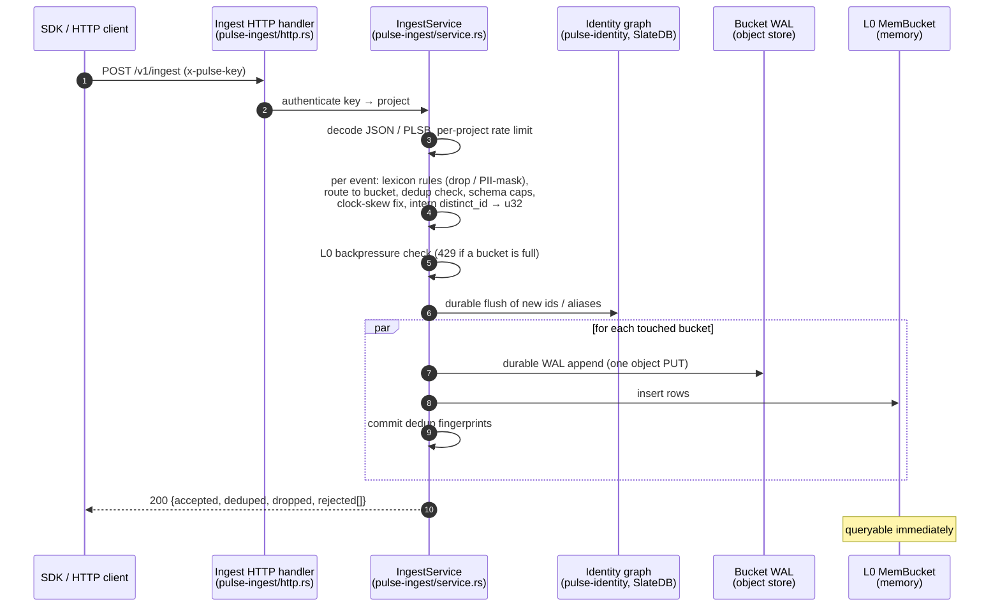
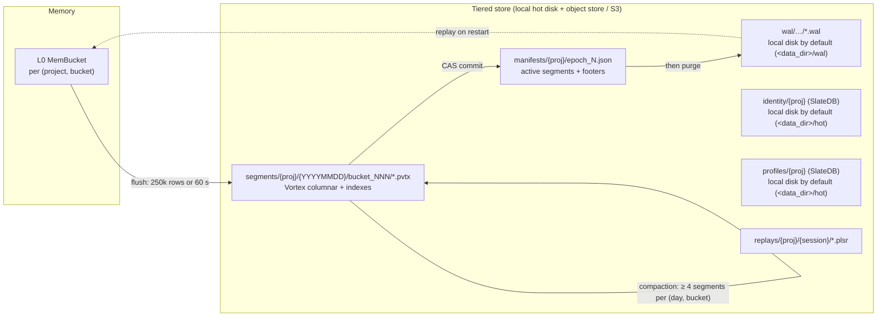
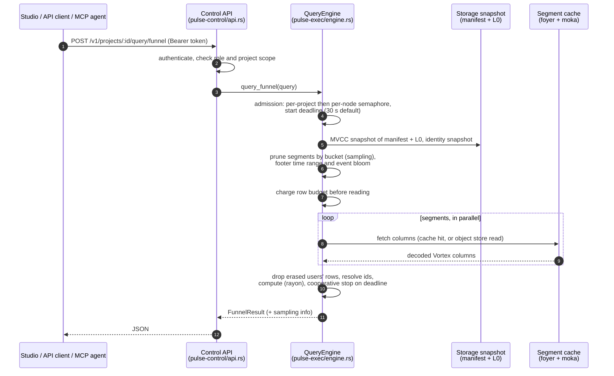

# How Pulse works

This page follows data through Pulse. It starts with an SDK call, then covers what happens on disk, how a query turns stored segments into a chart, and how replay and flags fit in. Each section names the source files it describes, so you can check any claim. For the map of components, start with [System architecture](architecture.md).

Pulse is **product analytics**: events, users, sessions, funnels, retention, flows, replay, flags and experiments. It does not ingest OpenTelemetry traces or spans, and it does not trace LLM or agent executions (see [Limitations](limitations.md#not-supported)). AI agents use Pulse as a *client*: they query your analytics over [MCP](mcp.md).

## 1. How events enter Pulse

### Instrumentation

You send events in one of three ways:

| Source | What it sends | Where |
|---|---|---|
| [Web SDK](web-sdk.md) (`@pulse-analytics/ts-web`) | JSON `{"events": [...]}` batches, replay chunks, profile operations | `sdks/ts-web/src/index.ts` |
| [Mobile core](mobile-core.md) (Rust + UniFFI, beta) | The same routes, from a disk write-ahead queue | `crates/pulse-sdk-core/src/lib.rs` |
| Your own code | Plain HTTP JSON: Pulse events, or Segment `track`/`page`/`screen`/`identify`/`alias` calls | [REST API](rest-api.md#ingest-ingest-key) |

Every SDK request carries a **public ingest key** (`pk_live_…`) in the `x-pulse-key` header. The key identifies the project. It can only write events and read flags, so shipping it in a browser is fine.

### What the SDK does before sending

The Web SDK does the following before anything leaves the device:

- **Gives each event an id.** `event_uuid` is the dedup key on the server.
- **Stamps two times.** `client_event_ts_ms` is when the event happened and `client_sent_ts_ms` is when it was sent.
- **Fills in identity.** It adds `distinct_id`, a `session_id` (a session ends after 30 minutes of inactivity) and a stable `routing_seed` for the device.
- **Applies your filters.** `propertyBlacklist` and `beforeSend` run first.
- **Strips URLs.** Query strings, fragments and credentials are removed from captured URLs. Replay text is masked.
- **Queues durably.** The queue lives in `localStorage` (or storage you pass in). It sends when the queue reaches `flushBatchSize` (default 20) or every `flushIntervalMs` (default 5 s). When the page is hidden, it sends with `fetch(..., {keepalive: true})`.
- **Retries failures.** Retries use exponential backoff with full jitter, capped at 60 s, and a `Retry-After` header sets the minimum wait. A `400`, `413` or `422` response drops the batch permanently. Any other failure keeps the events queued, and they keep their ids, so a resend is deduplicated.

### The ingest request

`POST /v1/ingest` accepts:

- **JSON:** a single event, `{"events": [...]}`, Segment `{"batch": [...]}`, or a top-level array (`crates/pulse-wire/src/batch.rs`).
- **Binary `PLSB` frames:** `Content-Type: application/x-pulse-frame`. A frame is columnar and zstd-compressed, and can use a pre-shared dictionary.

Limits on a request:

- The HTTP body is at most 8 MiB.
- A decoded batch is at most 64 MiB and 250,000 events, and decompression is bounded so a small body cannot expand into a huge one.
- Names are at most 255 characters, and string values are truncated to 8 KiB.

Field names are forgiving: `event`/`event_name`/`name`, `userId`/`distinct_id`/`anonymousId`, `timestamp` in seconds, milliseconds or RFC 3339, and so on (`crates/pulse-wire/src/event.rs`).

### The ingest pipeline

Steps 3 to 9 run in `IngestService` (`crates/pulse-ingest/src/service.rs`):

1. **Authenticate and decode.** The ingest key selects the project. The batch is decoded, and a per-project token bucket limits ingest to 20,000 events/s with a 5 s burst by default (`PULSE_INGEST_EVENTS_PER_SEC`, `PULSE_INGEST_BURST_SECS`). Over the limit, the node answers `429` with `Retry-After`.
2. **Apply governance.** [Lexicon](concepts.md#lexicon) rules can drop an event, drop properties, or mask PII properties *before* storage (`crates/pulse-ingest/src/governance.rs`).
3. **Route to a bucket.** Each event goes to bucket `xxh3_64(routing_seed) % num_buckets` (16 by default). All of a device's events land in the same bucket. Per-user work then never crosses buckets, and sampling can take whole users at a time.
4. **Deduplicate.** The server fingerprints each event: its id if it has one, otherwise a hash of its whole content. It checks that fingerprint against two rotating 15-minute windows per bucket. The windows are re-seeded from the WAL on restart.
5. **Apply schema caps.** One batch may add at most 128 new event names or 256 new property keys. A project may hold at most 8,192 event names and 16,384 property keys. Going over a cap rejects the **whole batch** with `422`.
6. **Correct the clock.** If the device's `sent_at` differs from server time by more than 5 s, the event time is shifted by that difference. `/import` never does this, because backfills are old on purpose.
7. **Write the identity graph first.** New distinct ids and aliases are flushed durably before any event that refers to them is written.
8. **Write the WAL, then memory.** For each bucket, under that bucket's append lock, the rows go to a write-ahead-log object (`wal/{project}/bucket_NNN/epoch_E_seq_S.wal`, CRC-checked), then into the in-memory **L0** buffer. Dedup fingerprints are committed only after the WAL write succeeds.
9. **Respond.** The node replies `200` only after the WAL write has succeeded. On the default local store, every object write is `fsync`ed, and so is its directory. An acknowledged event therefore survives a crash.

Response codes are listed in [Troubleshooting](troubleshooting.md#ingest-errors).

## 2. How events are stored

All persistent state goes through one `object_store` interface (`crates/pulse-storage/src/store_factory.rs`). Under the default `PULSE_HOT_STORE=local`, WAL prefixes (`wal/`, `wal_corrupt/`, `wal_dead/`, `agent_wal/`, `agent_wal_corrupt/`) route to `<data_dir>/wal` and SlateDB hot state (`identity/`, `profiles/`) routes to `<data_dir>/hot`, while segments, manifests and replays route to `<data_dir>/object_store` (or `s3://bucket`, `file://…`, `memory://` via `PULSE_OBJECT_STORE_URL`). Every local write (single `put` and `put_multipart` completion) is fsynced along with its parent directory.

### L0, flush and segments

- **L0 buffer.** L0 is an in-memory buffer per `(project, bucket)`. A bucket is flushed when it reaches 250,000 rows or turns 60 seconds old. A background loop checks every 5 s.
- **Backpressure.** If a bucket grows past its high-water mark (`PULSE_L0_MAX_ROWS_PER_BUCKET`, default 1,000,000), or in-memory rows exceed their byte limit (`PULSE_L0_PROJECT_MAX_MB`, `PULSE_L0_MAX_MB`), ingest answers `429 Retry-After: 1` until the flush catches up.
- **Flush.** A flush groups rows by day and writes one **segment** per `(day, bucket)`: `segments/{proj}/{YYYYMMDD}/bucket_NNN/{id}.pvtx`. It then commits a new **manifest** with compare-and-swap, then drops those rows from L0 and deletes the WAL objects it covered.
- **Segment contents.** A segment holds [Vortex](https://github.com/spiraldb/vortex) columnar data, a Roaring-bitmap inverted index for low-cardinality properties, and a session index (`crates/pulse-storage/src/segment.rs`). Inside a segment, rows are sorted by user and time, so per-user scans such as funnels and retention read data in order.
- **Footers in the manifest.** Each segment's **footer** is stored in the manifest, not in the segment file. It holds row and session counts, min and max time, a 64-bit event bloom filter, exact per-event counts, and HyperLogLog sketches (p = 10, about 3.25 % error) for the top 32 events. Many queries are answered, or have segments ruled out, from footers alone, without reading a segment.

### Manifests and compaction

- **Commits.** A manifest (`manifests/{proj}/epoch_N.json`, zstd-compressed JSON) lists the active segments and the WAL position they cover. It is created with "create if absent" semantics, so two writers can never both commit the same epoch. A losing writer reloads and retries, up to 8 times.
- **Old epochs.** The 16 newest epochs are kept, plus a 300 s grace period. A segment still in use by a running query is never garbage-collected.
- **Compaction.** When a `(day, bucket)` has 4 or more segments, they are merged into one. Compaction is also when [erased users](security-privacy.md#erasure) are physically removed.

### Encryption at rest (optional)

If you set `PULSE_BYOK_MASTER_KEY`, every object the storage engine writes (WAL, segments, manifests, replays, profiles) is envelope-encrypted with AES-256-GCM:

- Each object has its own random data key, wrapped by the master key.
- The object path is bound into the authenticated data.
- Data is encrypted in 64 KiB chunks, so byte ranges can still be read (`crates/pulse-storage/src/encrypted_store.rs`).

Without the key, objects are stored in plaintext. See [Security & privacy](security-privacy.md#encryption).

## 3. How identity works

Analytics counts *people*, but an SDK first sees an anonymous device. Pulse keeps a per-project **identity graph** (`crates/pulse-identity/src/lib.rs`) in SlateDB at `identity/{proj}`:

- **Dense ids.** Every `distinct_id` is mapped to a dense 32-bit id. Segments store that id, not the string.
- **Merging.** `identify(userId)`, or a Segment `identify`/`alias`, links the anonymous id to the user id with union-find. The user's root is marked *identified*.
- **History stays put.** Stored events are never rewritten. Queries resolve every id through the graph's canonical map at read time, so a user's events from before they logged in count as theirs.
- **Merge conflicts.** Merging two ids that are *both* already identified would combine two real people, so it is refused with `409`.
- **Durability.** Changes are written as a log in SlateDB with periodic checkpoints. Query-role nodes open the graph read-only and refresh it.

User and group **profiles** (properties set with `$set`, `$set_once`, `$increment` and so on) live in a separate SlateDB store at `profiles/{proj}` (`crates/pulse-storage/src/profile_store.rs`).

## 4. How queries work

Every query kind (insights, funnel, retention, flows, cohort, session search) follows the same path in `crates/pulse-exec`. The steps match the diagram:

1. **Admission.** A query must get a per-project permit, then a per-node permit. These are semaphores, with defaults of `cores/2` per node and 75 % of that per project (`PULSE_QUERY_MAX_CONCURRENT`, `PULSE_QUERY_MAX_CONCURRENT_PER_PROJECT`). A query that cannot get both within its deadline fails as overloaded.
2. **Snapshot.** The query reads a consistent snapshot: the current manifest, the L0 rows not yet flushed, and an identity snapshot. Writes that land meanwhile do not affect it, and events are visible the moment ingest returns `200`.
3. **Pruning.** The engine skips segments whose footer time range or event bloom filter cannot match, and segments in buckets that a sample leaves out.
4. **Budget.** The rows to be scanned are charged against a row budget (`PULSE_QUERY_MAX_ROWS`, default 250,000,000) *before* anything is read. Memory is charged as chunks load (`PULSE_QUERY_MAX_MEMORY_MB`, default 1024). Over either budget, the query fails cleanly instead of exhausting the node.
5. **Scan.** Segments are fetched and decoded in parallel through the segment cache. The cache is a foyer hybrid RAM and optional disk cache plus moka caches for columns and indexes, keyed by segment id. Segments are immutable, so the cache needs no invalidation.
6. **Compute.** Funnels, retention, flows and cohorts run on rayon. The compute loops poll a stop flag, so the deadline (`PULSE_QUERY_TIMEOUT_MS`, default 30 s) is enforced even mid-computation, and partial results are thrown away.

**Exact by default, sampled only when large.** `sampling: "auto"` is the default. A query stays exact while the estimated rows are under `PULSE_AUTO_SAMPLE_MIN_ROWS` (10,000,000). Above that, it reads a deterministic subset of buckets (25 %, 12.5 % or 6.25 %) and scales the result up. Because buckets hold whole users, a sampled funnel still follows each sampled user end to end. Every sampled result carries a `sampling` object (`is_sampled`, `sample_rate`, `scale_factor`, `relative_error_pct`, `method`), and the Studio shows it. Pass `"sampling": "exact"` to turn sampling off.

**Fast paths.** Two kinds of query skip reading segments and use footers only:

- Unfiltered *totals* with no breakdown.
- Unfiltered *uniques*, DAU, WAU or MAU over a long range with no breakdown, using the footer HyperLogLog sketches.

Results from HLL sketches are reported with `method: "hll_sketch"`.

**Correctness checks.** `crates/pulse-exec/tests/proptest_oracle.rs` compares the engine against an independent naive implementation, which shares no code with Pulse, on randomly generated data. Funnels, insights uniques and totals, and daily retention must match exactly.

The query body shapes are in [REST API → Queries](rest-api.md#queries-bearer-token), and the limits are in [Limitations](limitations.md#query-limitations).

## 5. How data becomes a chart

The Studio (`web/`) is a React single-page app that `pulse-node` serves from `PULSE_WEB_DIST_DIR`. It calls the same `/v1/...` API as everyone else, with relative URLs on the same origin:

- **Sign-in.** A Studio sign-in sets an HttpOnly `pulse_session` cookie (a `ps_…` session). If you sign in with an admin token instead, the Studio sends it as `Authorization: Bearer`.
- **Workspaces.** Each workspace, such as Trends, Funnels, Journeys, Retention, Replays, Users, Cohorts, Experiments or Events & privacy, builds a query body. It posts the body to `/v1/projects/:id/query/<kind>` and renders the JSON result.
- **Dashboards and saved reports.** These store query bodies in the control-plane database and run them again when you open them.

Agents get the same data through `POST /v1/mcp`. The MCP tools take simpler arguments, map them onto the same `QueryEngine` calls, and return JSON (see [MCP](mcp.md)).

## 6. How session replay works

Replay is **not** video and not an HTML recording:

- **What is recorded.** The SDK records a *wireframe*: element boxes, kinds and colours, and labels that are masked to `████` on the device unless you unmask them. Inputs, textareas, selects and `contenteditable` elements are always masked. Images become placeholders.
- **How it is sent.** Ops (full snapshot, node upsert or remove, pointer, network) are batched into `PLSR` frames: zstd-compressed and self-delimiting, at most 100,000 ops per chunk. They go to `POST /v1/replay/chunk` (`crates/pulse-wire/src/replay.rs`).
- **How it is stored.** Lexicon masking is applied again on the server. Chunks are then stored as immutable objects at `replays/{proj}/{session}/{seq}.plsr`.
- **How it is played.** `GET /v1/replay/:session_id` streams the chunks back, with `Range` support, and the Studio's `WireframePlayer` draws them. Events link to replay through `replay_offset_kb`. Rage taps (3 or more taps within 800 ms and 40 px), dead taps, errors and network calls appear on the timeline.

## 7. How feature flags and experiments work

- **Flag delivery.** Flags are defined in the control plane. Clients fetch a bundle with `GET /v1/flags/:ingest_key`, with ETag caching, and evaluate it **locally**. A flag check makes no network call.
- **Assignment.** Assignment is deterministic:
  - The rollout slot is `xxh3_64("{flag_key}:{distinct_id}") % 10000`.
  - The variant slot is `xxh3_64("var:{flag_key}:{distinct_id}") % total_weight` (`crates/pulse-wire/src/bucketing.rs`).
  - The same functions run in the SDKs and on the server, and shared test vectors in `sdks/bucketing_vectors.json` keep them in agreement.
  - Assignment uses the *current* distinct id, so `identify()` can move a user to a different variant.
- **Cohort targeting.** A flag that targets a cohort ships member *hashes*, not raw ids, in the public bundle. A targeted flag with no members fails closed.
- **Exposures.** `trackExposure` or `getVariant(key, {trackExposure: true})` records an exposure event.
- **Results.** Experiment results (`GET /v1/projects/:id/experiments/:exp_id/results`) are computed from those exposures and the goal events. They report lift, Holm-Bonferroni-corrected p-values, a Bayesian probability to beat control, and a sample-ratio-mismatch check (`crates/pulse-control/src/experiments.rs`).

## 8. How costs are calculated

Pulse has no usage metering, billing or cost tracking. There are no event or seat limits to meter. The "revenue" feature (`/v1/projects/:id/revenue`) sums the `amount` of *your* revenue events. It is product analytics about your business, not a charge from Pulse.

The AI Copilot sends prompts to an LLM provider you configure with your own key (BYOK). Pulse does not track what those calls cost.
