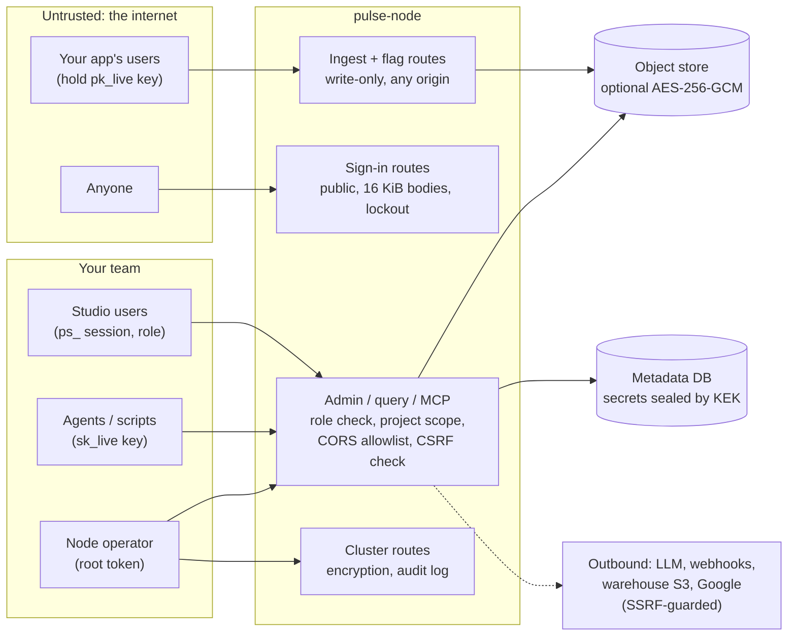

# Security & privacy

This page describes the security controls implemented in Pulse and what happens to the data you send. It lists only mechanisms that exist in the code, with the file that implements each one.

Pulse holds **no compliance certifications** (SOC 2, ISO 27001, HIPAA, etc.). Features named after a regulation, such as "DPDP" user erasure, are tools you can use toward your own obligations. They do not guarantee compliance.

To report a vulnerability, follow [SECURITY.md](../SECURITY.md) and use private reporting, not a public issue.

## Trust boundaries

## Authentication

| Credential | Format | Stored as | Can do |
|---|---|---|---|
| Ingest key | `pk_live_` + 48 hex | SHA-256 hash + prefix | Write events, profiles and replay for its project; read the flag bundle. Rejected on every admin route (`403`). |
| Project admin key | `sk_live_` + 48 hex | SHA-256 hash + prefix | Admin role on **one** project. Recommended for agents. |
| Root token | `sk_root_` + 48 hex, or your `PULSE_ADMIN_TOKEN` | Compared in constant time | Owner of every organisation; the only credential for cluster routes |
| Studio session | `ps_` + 64 hex, in an HttpOnly `pulse_session` cookie (SameSite=Lax, `Secure` on HTTPS) | SHA-256 hash, 30-day expiry | The user's organisation, as their role allows |

Notes on how these credentials behave:

- **Root token at startup.** If `PULSE_ADMIN_TOKEN` is unset, a new root token is generated on **every** start. It is written to `<data_dir>/root_admin_token` with mode `0600` and never logged.
- **Ingest key at first boot.** The first ingest key is printed to the log once.
- **Passwords.** Passwords are hashed with Argon2 (crate defaults, random salt). A dummy hash is checked for unknown emails so that response timing does not reveal which accounts exist (`crates/pulse-control/src/api/auth.rs`).
- **Login lockout.** 10 failed sign-ins for one email within 15 minutes → `429`. Password-reset requests: at most one per email every 5 minutes. Both limits are kept in memory per node.
- **Email verification.** A password sign-up gets no session until its email is verified. Pulse has no mailer, so links are written to the owner-only `outbox` file in the data directory.
- **Google sign-in.** Uses the authorization-code flow and checks state, nonce, issuer, audience, expiry and `email_verified`. The id_token's signature is **not** verified. The code relies on having received it directly from Google's token endpoint over TLS (`auth.rs`).
- **No other identity providers.** Pulse has no SSO/SAML, no SCIM and no MFA.

## Authorization and tenant isolation

- **Roles.** `viewer < member < admin < owner`. One deny-by-default check runs before every handler (`required_role` in `crates/pulse-control/src/api/accounts.rs`). The role table is in [REST API](rest-api.md#users-organisations-and-roles).
- **Organisation scope.** A Studio user can reach only projects whose `org_id` equals their own. Any other project id answers `404`, not `403`, so project ids do not leak (`authorize_and_check` in `crates/pulse-control/src/api.rs`).
- **Project scope.** A `sk_live_` key must match the project exactly. MCP tool calls are pinned to that one project.
- **Ingest scope.** The ingest key decides the project. A request body cannot name a different one.
- **Isolation level.** Projects share one process, one object store and one metadata DB. Isolation is logical: every path and every row is keyed by project id. There is no per-tenant process, database or encryption key.

## Browser protections

- **CORS.** Ingest and flag routes allow any origin, since SDKs run on your site. Admin routes allow only `PULSE_CORS_ORIGINS`.
- **CSRF.** A state-changing request authenticated by cookie must carry `Sec-Fetch-Site: same-origin` or a matching `Origin`. Without either it gets `403`.
- **Security headers** on the Studio and admin routes: a strict CSP (`default-src 'self'`, `frame-ancestors 'none'`), `X-Frame-Options: DENY`, `nosniff`, `Referrer-Policy` and `Permissions-Policy`. HSTS is sent when the request is HTTPS.

## Encryption

**In transit.** `pulse-node` serves plain HTTP. Terminate TLS in a reverse proxy; `deploy/Caddyfile` does this. The optional QUIC listener uses a self-signed certificate.

**Secrets in the metadata DB.** BYOK credentials (LLM keys, warehouse S3 keys, webhook secrets) and cluster keys are sealed with AES-256-GCM under a key-encryption key (KEK). The KEK is either `PULSE_VAULT_KEK`, or a `.pulse_cluster.kek` file next to SQLite. With Postgres or several nodes you must set `PULSE_VAULT_KEK`. Keep it outside your data backup.

**Event data at rest.** This is off by default. Set `PULSE_BYOK_MASTER_KEY` and every object the storage engine writes is envelope-encrypted (`crates/pulse-storage/src/encrypted_store.rs`):

- **Cipher.** AES-256-GCM with a random data key per object, wrapped by the master key, and the object path bound into the authenticated data.
- **Master key.** Either 64 hex characters, or a passphrase of at least 16 characters. A passphrase in this variable is stretched with Argon2id using a **fixed** salt, so a random 64-hex key is the stronger choice.
- **Plaintext objects.** Objects written before you enabled encryption stay readable. Set `PULSE_ENCRYPTION_STRICT=1` to refuse plaintext, but only for stores encrypted from day one.
- **Rotation.** `POST /v1/system/encryption/rotate` (root token) registers a new key. Rotated keys are held in an in-memory keyring. **Not verified:** that rotated keys survive a restart. Keep every master key you have used until this is confirmed.

Without `PULSE_BYOK_MASTER_KEY`, events on disk or in S3 are only as protected as the disk or bucket itself.

## What data Pulse collects

Pulse stores what your SDK or HTTP calls send, and nothing it collects on its own from the network:

- **Events.** Name, properties, distinct id, session id, a device routing id, and timestamps.
- **Web SDK context.** `$current_url` and `$referrer` without query string or fragment, `$pathname`, browser, OS and device class parsed from the user agent (the raw user agent is not sent), locale, window size, and UTM parameters and ad click ids taken from the URL (`collectDefaultContext` in `sdks/ts-web/src/index.ts`).
- **Errors.** With `captureErrors` (on by default), uncaught errors become `$error` events. They carry the message and the script path without its query string.
- **Network calls.** With `captureNetwork` (on with replay), each request's method, URL *without* query string, status and duration goes on the replay timeline. Calls to Pulse itself are skipped.
- **Replay.** Wireframes: element boxes, kinds, colours, and text masked to `████` on the device. Inputs, textareas, selects and `contenteditable` elements are always masked. Images are placeholders. No screenshots and no HTML.
- **Profiles.** Whatever you set with `identify`, `setUserProperties` and the other profile calls.
- **IP addresses.** The server does **not** record client IPs. The ingest path reads no `X-Forwarded-For` header or connection address. A `$ip` property you send yourself is stored like any other property.

## What you control

| Control | Where | Effect |
|---|---|---|
| Consent | `optOut()`, `optIn()`, `optOutByDefault` in the SDK | Nothing is sent while the user is opted out |
| Client-side filtering | `propertyBlacklist`, `beforeSend` | Remove properties, or drop whole events, before they leave the device |
| Replay masking | `maskSelectors`, `blockSelectors`, `unmaskSelectors`, `data-pulse-unmask` | Text is masked by default; you opt elements *in* |
| Server-side governance | Lexicon: `PUT /v1/projects/:id/lexicon/...` | Mark an event `dropped` (not stored), a property `dropped`, or a property `pii_masked` (masked at ingest, before storage) |
| Erasure | `DELETE /v1/projects/:id/users/:distinct_id` (admin) | See below |
| Export | `GET /v1/projects/:id/export`, warehouse export | Take your data out at any time |

## Erasure

`DELETE /v1/projects/:id/users/:distinct_id` resolves the user through the identity graph, which covers every id ever merged into them. It then:

1. Removes the user's events from the in-memory buffer.
2. Deletes their replay sessions.
3. Deletes their profiles.
4. Writes a tombstone with the erasure time.

From that moment, queries hide every event the user had sent up to the erasure. Compaction then deletes those rows from segments for good. Each erasure is recorded in `GET /v1/projects/:id/deletions` with a masked identifier (`crates/pulse-control/src/api.rs`, `erase_user_dpdp`).

Limits of erasure:

- **When rows disappear.** In tiered S3 storage (`PULSE_HOT_STORE=local`), S3 event segments are merged once at upload and at most once by cold S3 merge (`> 1 h` idle), so event rows erased *after* that merge stay in S3 segment bytes indefinitely behind the `erased_uids` tombstone (until then they are hidden, not gone; see [Limitations](limitations.md#data-limitations)). By contrast, AI agent erasure tombstones (`POST /v1/projects/:id/agent/erasure`) that carry an `expires_at` trigger physical purge/rewrite across L0, `agent_wal/`, local `hot/agent_segments/`, S3 `agent_segments/`, `agent_published/`, and `pending_gc` / `pending_s3_deletes` before `expires_at` expires.
- **Exports and backups.** Data already exported to a warehouse or captured in a backup is not touched.
- **New events.** If the same id sends new events later, they are counted. Erasure is not a block list.

## Data retention

Pulse has **no time-based retention or TTL**. Events are kept until you erase a user or delete the data directory or bucket. This is a known gap; see [Limitations](limitations.md#data-limitations).

## Outbound connections

Pulse makes outbound requests only for features you configure:

| Feature | Destination | What is sent |
|---|---|---|
| AI Copilot | Your LLM provider: Anthropic, OpenAI, Gemini or a custom endpoint (project `llm` BYOK credential) | Your prompt, aggregate metrics (insight counts, funnel steps, error-session count, revenue totals) and up to 6 session ids. Not raw event rows. |
| Alerts | Your webhook URL | `pulse.alert.triggered`, signed with HMAC-SHA256 (`X-Pulse-Signature-256`) |
| Warehouse export | Your S3 bucket | Parquet files of events |
| Google sign-in | Google OAuth endpoints | Standard OAuth exchange |

The outbound client follows no redirects, uses no proxy, pins DNS, and refuses private and loopback addresses unless `PULSE_ALLOW_PRIVATE_ENDPOINTS=1`. Pulse sends no telemetry about your node to anyone.
